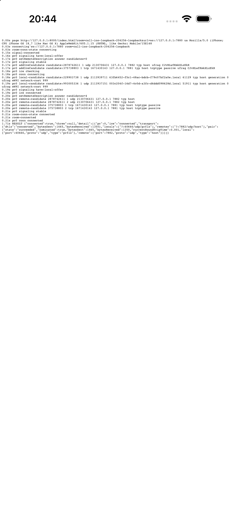

# WKWebView 回环 ICE 实验

验 iOS 的 WKWebView 能不能用 `127.0.0.1` 的 ICE 候选连本机的 WebRTC 对端：打开 ADR-0096 里“iOS 的回环候选”这一项，
结论写在 ADR-0096 的“验证结果”。通话页在 WKWebView 里经隧道映射连手机本机 `127.0.0.1` 的 LiveKit 端口，
WebKit 历史上会过滤回环候选，没验过。

实验用真 LiveKit（和插件同版本、同 `node_ip` 写法）和 `livekit-client`，不依赖 Wonton 栈；一个最小的 WKWebView 宿主 App
打开页面，页面把远程候选、ICE 状态和选中的候选对写回本机文件。

## 跑

Mac（模拟器）上：

```sh
./build-livekit.sh                       # 一次即可，产物 livekit-server 在本目录
bash run.sh                              # 全部四组，约两分钟，结尾删掉自己建的模拟器和服务器
cat results/*/page.log                   # 每组一份页面日志
```

在开发机上按要求经名额跑：把本目录复制到开发机（`~/wonton-src/<名字>/`），`ssh mini-ios run <名字> -- bash <目录>/run.sh`。
外接盘没挂上时 `run ios` 直接失败（退出码 6）。只跑某几组用 `MODES="loopback"` 放在命令前。

`run.sh` 自己起 LiveKit、页面服务器（`127.0.0.1:8000`）和模拟器 `call-ios-loopback`，按顺序跑四种配置：

| 模式 | LiveKit 只绑 | `node_ip` | 说明 |
| --- | --- | --- | --- |
| `lan` | `en0` | `en0` 的地址 | 对照：普通局域网地址能连 |
| `loopback` | `lo0` | `127.0.0.1` | 目标场景，跑两次 |
| `ipv6` | `lo0` | `::1` | 回环的 IPv6 写法 |

服务器地址只靠 `rtc.node_ip` 改写候选，和插件里 `NODE_IP=127.0.0.1` 的做法一致；`rtc.interfaces` 只留一张网卡，
是代替 App 的映射，让 127.0.0.1 在本机真的有人听。

## 看什么

`results/<模式>/page.log`（页面日志里 `RESULT` 一行是结论：`connected`、`transport` 的 DTLS 状态和字节数、
选中的候选对）。成败、连上耗时、选中的远端候选是不是回环地址，都从这一行和 `remote-candidate` 行读。
`results/<模式>/livekit.log` 是服务器侧日志，可以核对它发出的候选；`screen.png` 是页面当场的样子。

这是回环一组跑通时页面的样子（`127.0.0.1` 进 `addIceCandidate`，0.19 秒 ICE 连上，DTLS connected）：



## 边界

- 只覆盖 ICE 候选能不能用、信令 WebSocket 能不能连（页面连 `ws://127.0.0.1:7880`）。媒体捕获权限、真机、
  Element Call 页面本身不在这里，见 ADR-0096 的“待验证”。
- 模拟器和宿主共用回环，真机行为可能不同。
- `site/vendor/livekit-client.esm.mjs` 是 `livekit-client@2.23.0` 的原样 ESM 产物（Apache-2.0），
  和 ADR-0072 的 Android 实验同版本。
