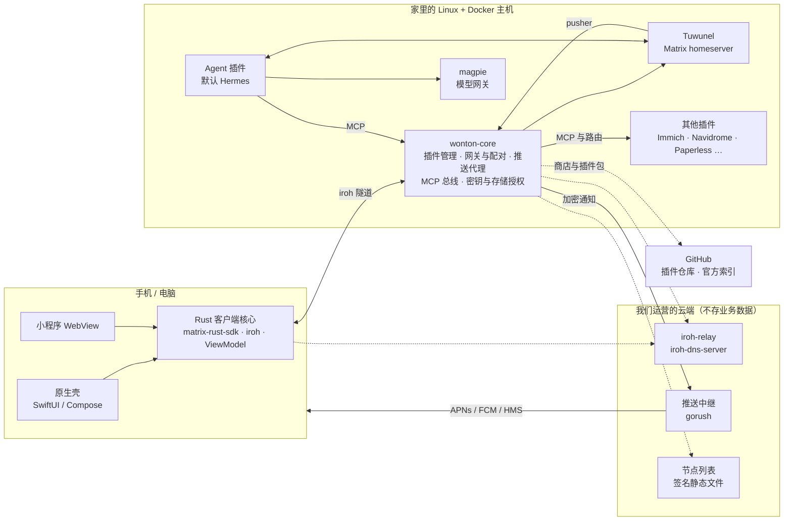

# 架构

本文描述 Wonton 的目标架构。每个选择的理由见对应的 [ADR](adr/README.md)。

## 一句话

家里一台 Linux + Docker 主机上跑着一个薄的 Rust 核心容器，它用 Docker 管理所有插件；自托管的
Matrix 服务器（Tuwunel）是所有会话的事实源；Agent 和插件都以 Matrix bot 的身份和人对话；手机上的
原生 App 由一个厚的 Rust 客户端核心驱动，经 iroh 隧道连回家；推送经我们运营的中继转发密文。

## 组件总览



### 家里的服务器

| 容器 | 类型 | 职责 |
| --- | --- | --- |
| `wonton-core` | 核心 | 插件管理器（经 Docker API 安装、升级、启停、健康检查、日志；Docker Hub、ghcr、quay 的镜像可以经加速地址按摘要拉，按仓库分名单，ADR-0074）；网关与配对（iroh 入口、HTTP 反向代理、设备与用户、会话鉴权）；推送代理；MCP 总线；密钥库与存储授权。系统服务里唯一挂载 Docker socket 的容器（升级器见下；声明了 `docker.socket` 的插件见 ADR-0036）。 |
| `tusd` | 核心组件 | 设备上传文件的可续传接口（tus），只在核心的私有网络里，鉴权和编号由核心决定（ADR-0020）。 |
| `wonton-egress` | 核心组件（配了代理才有） | 出口容器：把出网插件的请求转给主人的代理（ADR-0023），或者装着的代理插件（ADR-0039）。 |
| `tuwunel` | 核心组件 | Matrix homeserver，默认关闭联邦。会话、历史、多端同步、家人群聊的事实源。 |
| `hydra` | 核心组件 | OIDC 提供方，插件的单点登录（ADR-0009）。 |
| `mailpit` | 核心组件 | 收插件应用发的信（SMTP），接入申请了 `notify` 的插件网络，只收发给家里人的内部邮箱；核心取走后转进聊天（ADR-0056）。 |
| 第三方 App 入口 | 核心组件（主人打开才有） | 入口容器、局域网转发、连接器和 lego，由核心管理（ADR-0021）。连接器是 TCP 转发、frpc 或 cloudflared，主人在设置里选，公网访问有总开关（ADR-0090）；lego 用主人的 DNS 服务商（ADR-0089）。 |
| `hermes` | 默认插件（可替换） | 默认 Agent，以 Matrix bot 身份接入；一个 Hermes profile 对应一个 Bot。核心启动后自动装一次，主人卸掉就不再装（ADR-0007）。 |
| `magpie` | 系统插件 | 模型网关：provider 和 key 只配一次，所有插件共用。主人换不掉；我们换实现时 Agent 不用改（ADR-0008）。 |
| 其他 | 可选插件 | Immich、Navidrome、Paperless-ngx、Ollama、Syncthing、Samba 等。 |
| `wonton-updater` | 一次性容器 | 升级核心时拉起，用核心自己的镜像：拉新镜像、重建核心、健康检查，失败回滚（ADR-0025）。 |

### 云端

没有用户账号，也不存业务数据。第三方 App 入口存的是运行它必需的数据，见 [ADR-0012](adr/0012-updates-release-cloud.md)。部署安排见 [GOAL](GOAL.md) 的 M2。

| 服务 | 选型 | 说明 |
| --- | --- | --- |
| 中继 | 官方 `iroh-relay` 镜像 | 打洞失败时转发隧道流量。准入只认 endpoint ID，见 ADR-0048。 |
| 发现 | 官方 `iroh-dns-server` 镜像 | 家里服务器换网络后，App 靠它找到新地址。 |
| 推送中继 | gorush 加一层鉴权 | 只接收密文，转发到 APNs、FCM、华为 HMS。 |
| 目录 | 签名静态文件 | 中继节点列表。插件的官方索引在 GitHub 上，签名以后也能经这里分发（ADR-0017）。 |
| 镜像 | GHCR 加国内镜像仓库 | 安装脚本按网络选择。 |
| 第三方 App 入口 | frps、家名服务、PowerDNS、acme-dns | 只按 SNI 或端口转发，不解密（ADR-0021）。 |

### 客户端

| 端 | 技术 | 说明 |
| --- | --- | --- |
| iOS | SwiftUI | 外加通知扩展（解密推送）；录屏扩展留给 M2 的屏幕共享。 |
| Android | Jetpack Compose | 默认“保持连接”前台服务；UnifiedPush 是设置里的高级选项，推送服务内本地解密（ADR-0003）。 |
| 桌面（M2） | Compose Multiplatform | 与 Android 共享 UI 模块。 |
| Web（M3） | Compose 编译到 Web | 核心在服务器上运行，浏览器经 WebSocket 收发。 |
| 客户端核心 | Rust + UniFFI | matrix-rust-sdk、iroh、本地代理、状态、ViewModel（含设置首页 `SettingsViewModel`）、行为测试。 |

界面文字在两端各自的本地化资源里，语言跟随系统，也能按平台惯例单独设置；客户端核心只给类别和原始值，App 的语言经 `Accept-Language` 带给家里的服务器和插件页（ADR-0043）。服务器把语言按人记下，插件经 OIDC 的 `locale` 声明和核心 MCP 的 `wonton__user_locale` 工具按人取，默认语言由插件自己定。

客户端核心的“详情”用 `crates/wonton-client/locales` 的 Fluent 目录写，按 `SetLanguages` 第一项（App 在用的语言）协商，不支持的退到英文；一次请求用开始时的语言，上游原文和错误码原样嵌入，日志用英文。`CoreError` 的字段不变，前缀由客户端注册给协议 crate 的格式化函数按语言生成，不增加 UniFFI 类型。客户端和服务器共用 `wonton-l10n`（目录、CLDR 协商、一致性检查），资源和当前语言各自持有。

系统入口（桌面小组件、系统搜索、iOS 控制按钮）不跑客户端核心：核心把当前服务器的最近会话、默认 Agent、联系人和插件投影成
`wonton-protocol::widget` 的快照，写到数据目录下的 `widget/snapshot.json`（iOS 在 App Group 容器里），入口只读这份文件渲染，
点了经 `wonton://` 链接进 App（ADR-0100）。

账号槽位既可以是配对的 Wonton，也可以是外部 Matrix 账号；导航条目和应用页操作由客户端核心给出，
壳不按槽位种类自行隐藏。好友身份、分组、插件分享和 OpenID 连接的边界见 [ADR-0051](adr/0051-friends-and-plugin-sharing.md)；
其接口契约在 `wonton-protocol` 的 `friends`、`sharing`、`share_transport`、`matrix_login` 模块。

分享页的身份是 `TabRef::SharedApp { owner_user_id, plugin_id }`，与本机插件及其他来源的同名插件隔离。
同一来源的网页共用 `SharedAppsSource.state` 在 `Ready` 中提供的本地代理；连接结束便撤下代理，保留的旧列表不代表授权。
两端沿用插件页面容器与主题、语言桥，保留分享方的 `web_url`，不借用自家 `HomeViewModel` 的代理。

插件详情页的主人密钥由 `ListOwnerSecrets` 展开后列出，`ShowOwnerSecret` 才向服务器取一项值。
`PluginsViewModel.owner_secrets` 只保留展开中的临时显示状态，不写入缓存；收起、离页、进入后台或换服务器时清除，
晚到的请求不能重新显示。再次展开重新取列表和值，复制由原生壳使用系统剪贴板完成。

服务端 `friends` 模块持有 `core/friends.json`：Matrix 好友、本机插件用户名、分组及最后打开分享时间。
Matrix 邀请流程只在对方同意后调用存储 API；本机账号分配须同时保留好友墓碑里的用户名，避免和插件账号混淆。
授权消费者先订阅完整快照再校验，连接与授权绑定 `access_generation` 和分组成员代次；删好友再加回、移出组再加回都不能恢复旧连接。
服务端另有一组分享组件：`friends` 存好友和固定用户名，`shares` 存授权，`share_identity` 按 Matrix 服务器名认人，
`gateway::sharing` 校验每次请求并在授权失效时拆掉长连接，`wonton-tunnel::sharing` 是 `wonton/share/0` 的两端。
`wonton/share/0` 连接经 OpenID 认证后只拿到授权里的插件；认证前不转发任何网页请求。好友打开网页时由网关按
`{user}`（固定用户名）、`{name}`、`{role}=friend` 填身份，`sso: oidc` 只发 `groups=["friend"]`。

## 主要链路

### 安装与配对

1. 一行安装脚本拉起 `wonton-core` 和系统插件，并让用户选择存储目录。
2. 核心生成服务器的 iroh 身份。还没有配对的设备时，局域网状态页和安装终端显示首次配对码的二维码，码里有
   服务器 endpoint ID、中继和直连地址和一次性密钥（格式见 ADR-0009 的“接口：扫码配对”）。
3. App 扫码后经 iroh 连接核心、出示密钥。核心记下这台设备的 endpoint ID（QUIC 握手认证过的身份，以后只接受
   已配对设备），首次配对码随之作废。设备再经隧道要一次性的 Tuwunel 登录 JWT，用它自己登录（方案见 ADR-0009
   的验证结果）。
4. 之后 App 每次启动都经隧道连回；服务器换了网络，App 通过发现服务找到它。
5. 以后加设备，在已配对的 App 里点“添加设备”出码给新设备扫；设备都丢了，在服务器终端执行 `sudo wonton pair`。
   信任边界是服务器终端和已配对的设备，能接触局域网不算可信（理由见 ADR-0009）。
6. 显示名和邮箱在 App 里填，存在核心里，单点登录从那里取显示名（ADR-0030）；插件拿到的邮箱是每人一个、不变的内部邮箱，应用发来的信转进这个人的 Wonton 私聊（ADR-0056）。

### 新用户引导

服务器比 App 旧时，引导不整页报错：某个接口回 404、而服务器报的版本比这个接口要的旧（`minimum_server_version`），客户端核心归成“服务器太旧”，这一步整步不显示、完成时也不做它；连引导接口都没有时整段不出现，只留一条升级服务器的提示。服务器不旧却回 404 的照旧按原类别报。服务器版本从核心升级状态的 `current.version` 取，取不到就不判旧。

配对之后，App 依次带主人填资料、选默认的 Agent、接模型、按需求选应用，最后一页列出全部选择和权限，点完成才一起执行：保存资料和模型，在后台装 Agent 和应用，然后进入聊天。每一步都能跳过，核心只记走没走完。Agent 名单和推荐清单放在官方索引里，核心取来交给 App，不用发版。key 的测试和保存由模型网关声明的命令执行，核心只转交，不存。设计见 [ADR-0034](adr/0034-onboarding-and-help.md) 和 [ADR-0038](adr/0038-multi-step-cards.md)。

### 帮助文档

用户问 Wonton 和 App 的用法时，Agent 调核心的 `wonton__help`。文档在公开仓库 wonton-docs 的 `user/`，核心镜像带一份，有网时按官方索引记的提交取新版，核对 sha256 后存盘。Agent 插件自带一个指路的 skill，文档只有核心这一份。设计见 ADR-0034。

### 聊天

App 的 Matrix 客户端请求进入客户端核心的本地代理，经 iroh 隧道到核心网关，再转给 Tuwunel。
Bot（Agent 插件）作为 Matrix 用户收到消息，通过 magpie 调模型，通过 MCP 调工具，再把回复发回房间，
由 Sliding Sync 同步到所有设备。

输入框里选的照片和文件先进附件区预上传；一次发送里的附件全部传完、文件授权给房间以后才发第一条事件，几条事件带同一个分组标记，
主人的字在最后一条上，Bot 按标记收齐再开一轮（[ADR-0094](adr/0094-chat-attachments.md)）。
从系统分享面板分享进来的照片、文件和文字由壳放进数据目录的收件目录（iOS 由分享扩展写进 App Group），核心认领后出分享页，
主人选好聊天点发送，作为一条待发消息走同一套发送（[ADR-0097](adr/0097-share-in.md)）。

### 推送

1. App 把平台给的推送地址和本机的推送公钥（Web Push 的推送订阅）经隧道登记给核心，并在 Tuwunel 注册指向核心
   推送代理的 pusher。
2. 有新消息时，Tuwunel 调用核心推送代理（Matrix Push Gateway 接口）。
3. 核心用该设备的公钥加密通知（房间、消息 ID 和发送者；聊天是端到端加密的，推送里没有正文），按 Web Push
   （RFC 8030、8291）发到推送地址。
4. 推送地址来自 UnifiedPush 分发器（如 ntfy），或者是我们的中继为 FCM、APNs、HMS 令牌开的；中继校验发送方服务器
   身份并限速，再转发。
5. App 在本机解开通知，经隧道取回这条消息、在本机解密后显示。中继和苹果、谷歌只看到密文。设计见
   [ADR-0003](adr/0003-matrix-and-encrypted-push.md) 的“设计：加密推送”。

### 小程序

App 打开插件网页时，WebView 以客户端核心的本地代理为 HTTP 代理（原样保留 `Host`），经隧道到核心网关。
本地代理只接受带本次会话凭据的连接，同机的其他 App 借用不了配对身份。Android WebView 给不了跨源隔离，要它的页面交给系统浏览器，
经客户端核心在回环上开的浏览器入口进同一个本地代理，入口按主机名里的秘密标签认请求（ADR-0033 的“跨源隔离”）。核心在进程内服务隧道流，
把隧道认证的设备身份交给网关；网关按设备登记表认出这台设备的人（主人和家人，ADR-0045），按插件清单把请求路由到插件容器，不需要 Cookie
会话（局域网浏览器仍用核心会话）。新插件默认用应用自带的登录（`sso: none`，ADR-0022），主人第一次打开时在
应用里注册管理员，网关只放主人进来，插件开了“家人能用”时也放家人（ADR-0045）。声明 `sso: oidc` 时，核心在安装时为它注入 OIDC 客户端配置，用户
进入时自动登录，身份是当前这个人（主人和家人各有账号）；声明 `sso: proxy` 时，由网关代为带上当前人的用户名或应用自己的密钥。

每 Bot 网页的目标契约不改清单：`webui.service` 属于 `bots.services` 时，每个 Bot 一份 UI 和独立 origin。
默认 Bot 沿用插件 slug；非默认 Bot 用 `bot--<Bot 名>-<截短的插件 slug>-<8 位 SHA-256 十六进制摘要>`，
只截 slug，不截 Bot 名，标签最多 63 字节；在现有分配锁下先检查并预留主机标签，再创建 Matrix 身份、凭据、
数据目录或容器，撞名回 409 且不产生这些部分副作用，不改名或回退默认 Bot；崩溃恢复不承诺跨系统回滚。
入口仍原样追加 `webui.path`，精确命名算法见插件规范，不从主机名反推 Bot 身份。
Bot 服务的 `WONTON_APP_URL`、OIDC 回调登记和精确主机 Cookie 跟随对应 origin，不设父域 Cookie。
网页权限复用插件的同一个“家人能用”开关，默认只给主人；不按 Bot 归属或聊天参与者另行放行，好友沿用已支持的插件分享授权。
开关旁提醒主人开放的是同一个 Bot 的应用及登录入口，家人可能读取、修改同一应用状态；是否按人隔离由上游账号模型决定，
共用会话凭据时须明确提示共用登录状态，不把多用户应用一概视为同一个登录。
Agent／插件网络来源在 `self_request` 例外前拒绝；默认与非默认 Bot 主机名仍在自己的插件网络解析到网关，
容器内 `curl "$WONTON_APP_URL"` 的目标行为改为 403 `permission_denied`，不是 DNS 失败。
同插件网络容器仍可直连彼此端口，网关不提供这条路上的沙箱；不增加局域网端口或宿主权限。
家人登录前由四语言壳资源说明服务器主人可以查看、管理登录状态。
完整规则和错误类别见 [ADR-0045](adr/0045-family-members.md#插件网页和工具)；
[`bot_web` 协议](../crates/wonton-protocol/src/bot_web.rs)区分 Bot 页身份、可用性和失败原因。
Bot 页使用 `TabRef::Bot { bot: BotRef, path: Option<String> }`，不保存 URL，不降为插件页或公网网页。
`None` 路径打开对应 `BotView.web.Ready.page.url`，`Some(path)` 仅允许同 origin 内的路径（含查询和片段）；
选择沿用 `Action::SelectTab`，固定沿用 `PinTab`、`PinCurrentPage` 和 `Panel`，`PlacedTab` 保留同一 Bot 身份及路径。
实现时把聊天的 `BotView` watch 通道接入 `TabsLink`，网页状态变化时重算 `TabsViewModel` 的 `TabPage`；
URL 只来自精确匹配该 `BotRef` 的 Ready 页面，不读 `plugin.web_url`，桥和媒体以 `TabPage.url` 的精确 origin 为准。
`BotView.web: None` 没有验证可用的 URL；未知、缺失或错误时不发页面 URL，断连或身份变化时清空，不猜 URL 或回退默认 Bot。
Bot 页复用既有页面容器、桥、媒体和 `--wonton-*`，不另造壳层 WebView、不省略桥。
这是接口契约，不暴露每 Bot 网页运行时入口；尚不支持该页面的客户端明确拒绝，不转开其他页面，也不代表端到端验证通过。

插件整体异常时网关按服务看：清单 `webui` 指向的服务现在能用（容器在运行、健康检查没失败）就照常转发，网页里
依赖坏掉的部分由应用自己报错，插件在列表里照旧是异常（原因列出坏掉的容器和它的探针）；它停了或不健康、插件在
装、卸、升级、停止时才回 503 并写明原因。核心重启后核对也是逐个服务算的：一个容器没起来不影响别的服务的入口，
MCP 服务和模型网关同一条规则，局域网端口本来就直连各自的容器。

插件网页能固定到底栏，也能全屏（只留一个胶囊），主题令牌由 App 注入，页面和 App 之间用 MCP Apps 的方法名。Agent 能写插件
并经总线装上，走和上传相同的校验和确认。设计见 [ADR-0033](adr/0033-plugin-tabs.md)。

### 第三方 App、局域网端口和出网

三条不经隧道的路，都要清单声明：第三方 App、外部回调和访客链接经公网子域名或局域网直连到入口容器（ADR-0021、ADR-0090）；插件把清单列出的端口发布到
局域网（`network.lan`，ADR-0019），网页端口要主人打开 `lan_webui`（ADR-0023）；出网插件经出口容器走主人的代理或代理插件（ADR-0023、ADR-0039）。
宿主网络的插件按 ADR-0036 由核心配中继，网页和 MCP 经插件数据目录里的 unix 套接字进网关和总线，宿主防火墙不用改。
插件之间按能力依赖，使用方连 `<能力>.wonton.internal`，由核心按确认记录转发给选用的提供方：HTTP 能力经网关（ADR-0053），
`mqtt` 这类 TCP 能力经核心的四层中继（ADR-0092）。插件网络之间不互通。

### 插件安装

1. 来源：官方索引、GitHub 上的社区插件、主人添加的仓库、第三方索引、上传的插件包（ADR-0031），或 Bot 写好的插件包
   （ADR-0033）。插件包是仓库根目录或其中一个子目录：官方插件集中在 `wontonapp/wonton-plugins`，每个插件一个子目录；第三方
   插件仍一个插件一个仓库。发布就是打 tag，子目录插件用 `<子目录>/v<版本>`（ADR-0017、ADR-0079）。
2. 核心校验清单，生成权限清单。
3. 主人在 App 里确认权限；如果是 Bot 发起的安装，确认按钮出现在聊天里。
4. 核心准备插件要用的身份和凭据（Bot 账号与令牌、模型网关凭据、插件密钥、OIDC 客户端），渲染
   compose 时注入它们和应用数据目录、已授权的共享文件夹（变量见插件规范），并为插件建独立的
   Docker 网络：插件经核心访问模型网关和 Tuwunel，出网规则见插件规范。
5. 经 Docker API 启动，健康检查通过后注册网页路由和 MCP 端点，然后通知主人。

同插件服务可用 Compose 的 `network_mode: service:<服务>` 共用网络命名空间，目标必须使用插件网络且与共用者属于同一
Bot 组。网页、MCP 和局域网端口登记在目标上；核心等目标运行后再建共用者，重建目标时一起换掉共用者，避免 Docker 的
`container:` 模式继续绑定旧容器 ID。网页可按 Bot 指向同组目标，MCP 和能力提供方仍只用全插件一份的服务。

镜像由 Docker 守护进程拉取，不经插件的出口容器。主人打开镜像加速后，核心只把 Docker Hub、ghcr.io、quay.io 上按摘要固定的引用
按各仓库的名单顺序改到加速地址，一个站拉不下来就换下一个；由 Docker 校验内容，并在本地核对 `RepoDigests`。全都失败直接报错，
写明试过哪几个站，不退回直连。名单来自官方索引，Docker Hub 的还能手填，不改宿主 Docker 配置。
核心启动后和主人测速时检测 Docker Hub 直连，只推荐、不自动打开；Docker 守护进程自己配了 HTTPS 代理时不测直连，也不推荐。

### Agent 调工具与确认

Agent 通过 MCP 调用核心 MCP 总线。总线按 Bot 放行：主人对某个 Bot 单独关掉的插件，这个 Bot 看不到、调不了它的工具
（[ADR-0066](adr/0066-plugin-forms.md) 第 5 节）。敏感操作（装卸插件、删文件、
改设置、对外发送）不会直接执行：核心记下一张确认卡片并推送给主人，App 把它显示在发起的会话里和“等你确认”列表里
（卡片不进 Matrix 房间，来源会话由 Agent 一侧报、核心核对），主人在 App 里点确认（经隧道请求核心）后才执行，并写审计日志，
最后把结果返回给 Agent（ADR-0016）。主人可以调整插件工具的确认（ADR-0024）。Agent 有事要主人定时，在 Bot 私聊里用文字问（ADR-0038）。

Bot 用 `wonton__get_profile`、`wonton__set_profile` 读写自己的资料，无需确认；名字规则、头像检查和每小时成功次数上限由核心统一执行，见 [ADR-0044](adr/0044-bot-profile-and-status-avatars.md)。

### 文件

核心提供文件服务：每个文件一个编号，指向共享文件夹里的原文件、插件的资源或设备上传的文件。工具结果里的文件，总线换成编号交给 Agent；Agent 分享后拿到一个
`wonton://file/<编号>` 链接，放进回复。App 认出链接显示成卡片，字节经隧道走 HTTP（下载用 `Range`，上传用 tus）。设备上传的文件放进共享文件夹 `transfers`，算主人自己的文件。App 之间互传用同一种链接（ADR-0020）。

### 链接预览

聊天里的链接卡片由家里的核心去取：主人和家人的设备经隧道 `GET /_wonton/api/link-preview?url=`，核心自己解析域名、拒绝内网地址，经主人的出网代理
（没配就直连）取网页开头和 `og:image`，结果连同图片按网址缓存在核心数据目录。Bot 和插件拿不到这个接口，Tuwunel 的 `preview_url` 仍关着。
见 [ADR-0065](adr/0065-link-previews.md)。

### 升级

核心经 Docker 查渠道（`stable`）的 tag 指向哪个 digest，有新版本时 App 里显示；下载好目标镜像后，核心在一次性容器里对它跑
`plugin compat`，把会因此新失效的已装插件列在确认页上（ADR-0085）。主人确认后，核心拉起 `wonton-updater`：
拉新镜像、重建核心容器、健康检查，失败就回滚到旧镜像；核心断开期间状态记在文件里（ADR-0025）。插件按官方索引里的版本或仓库的新 tag 提示升级，主人确认后
只换容器，失败回滚（ADR-0017）。核心启动核对插件时，容器上记的渲染结果和新核心渲染的不一致就照安装的路径重建，卷和数据目录不动（ADR-0063）。

主人启动一个容器不在的插件（开发栈 down/up、容器被手动删掉、Docker 数据丢失之后），核心按已安装记录照安装的路径重建容器再启动，
插件网络不在也照安装的规格重建，卷和数据目录不动；镜像拉不到、记录读不懂这些做不了的，按原因报类别，App 给出对应的下一步（如重新安装）。

## Bot 与 Agent

- Bot = 一个 Matrix 身份 + 一个驱动它的 Agent 插件。核心负责给 Bot 分配身份、权限、模型访问和工具，
  不和具体 Agent 耦合。
- 名字、静态头像和状态头像组以 Matrix 资料为准；主人经隧道接口修改，Agent 可经自身 Matrix 身份或核心工具修改。清单只初始化新账号的名字和静态头像，状态头像只补不存在的字段。核心写入共用 `PluginManager::profile_revisions()` 的版本表，见 [ADR-0044](adr/0044-bot-profile-and-status-avatars.md)。
- 会说 Matrix 的 Agent 直接接入（Hermes 的 Matrix 平台）。支持 ACP 的 Agent（Codex、Claude Code、
  Gemini CLI、OpenCode 等）通过通用“ACP 桥”插件接入：一个聊天房间对应一个 ACP 会话，ACP 的权限
  请求对应聊天里的确认按钮。
  `agent_acp` 的跨插件调用由核心在创建会话前核对并重写链载体；载体核对规则见
  [ADR-0061 第 12 节](adr/0061-agent-runtime-and-frontends.md#12-跨插件传链sessionnew-的-_meta-里带链载体)。
- 模型默认经 magpie。订阅账号只在 Agent 官方程序里登录，不经 magpie（ADR-0034）。
- 每个家人有自己的账号、私人 Bot 和私人空间，主人可以建共享 Bot 拉进家庭群；同机的 Bot 之间经联系人互发消息，网关限频率和跳数。见 [ADR-0045](adr/0045-family-members.md)。
- 核心经隧道的 `GET /_wonton/api/bots/activity?after=<rev>` 长轮询给出各 Bot 的运行、模型请求、工具调用和待确认事实，客户端核心结合 Matrix typing 合成状态（[ADR-0044](adr/0044-bot-profile-and-status-avatars.md)）。

## 安全模型

- Agent 是不可信执行者：独立容器，只看得到自己的工作区和被授权的文件夹，没有 Docker socket，
  也没有宿主 root。
- 插件权限写在清单里，安装时确认。高权限声明了就给，按风险分三级提示；Docker socket、特权模式这类等于交出宿主 root
  的单独确认；Agent 和 Bot 插件拿不到它们（ADR-0036）。
  显卡由核心按宿主实际有的显卡交给清单指定的服务（ADR-0018）。
- provider key 等密钥只存在核心密钥库和 magpie，插件拿到的是受限令牌。
- 来自其他 Bot、网页、文件的内容都视为不可信输入。

## 仓库布局

```text
crates/
  wonton-protocol/   核心 API、ViewModel、插件清单类型：跨端唯一事实源，生成 Swift/Kotlin 类型
  wonton-tunnel/     iroh 隧道，服务端与客户端共用
  wonton-matrix/     Matrix 客户端封装（matrix-rust-sdk），供客户端核心使用
  wonton-l10n/       Fluent 目录、语言协商与资源一致性检查，客户端与服务器共用
  wonton-core/       服务端核心
  wonton-client/     客户端厚核心，UniFFI 导出
apps/
  ios/               SwiftUI 壳、通知扩展
  compose/           Kotlin Multiplatform：共享 UI 模块、android、desktop（M2）
design/              App 设计系统的输入：令牌、图标白名单和上游 SVG（ADR-0026）
plugins/             示例插件与预装插件锁文件 system.lock；官方插件各在自己的仓库（ADR-0017）
cloud/               中继、发现、推送中继、目录发布的部署配置
deploy/              一行安装脚本、compose 模板、升级器
docs/                文档
scripts/             CI 与开发脚本
```

## 选型

| 能力 | 选型 | 许可证 | 状态 |
| --- | --- | --- | --- |
| Matrix homeserver | Tuwunel | Apache-2.0 | 已定 |
| 客户端 Matrix SDK | matrix-rust-sdk | Apache-2.0 | 已定 |
| 隧道 | iroh 1.x（参考 dumbpipe） | MIT / Apache-2.0 | 已定 |
| 中继与发现 | iroh-relay、iroh-dns-server | MIT / Apache-2.0 | 已定 |
| 推送中继 | gorush（APNs、FCM、HMS） | MIT | 已定；小米、OPPO、vivo 在 M2 |
| Docker 管理 | bollard | Apache-2.0 | 已定 |
| 默认 Agent | Hermes Agent | MIT | 已定 |
| Agent 接入 | Matrix 原生、ACP | Apache-2.0（ACP 规范） | 已定 |
| 模型网关 | magpie | MIT | 已定 |
| MCP 总线 | 官方 Rust SDK rmcp，在核心里做最小聚合 | Apache-2.0 | 已定（ADR-0006） |
| 插件商店 | 插件仓库按 GitHub topic 发现，官方索引是一个仓库（参考 magpie） | — | 已定（ADR-0017） |
| OIDC 提供方 | Ory Hydra | Apache-2.0 | 已定（ADR-0009） |
| 可续传上传 | tus 1.0、tusd | MIT，独立容器 | 已定（ADR-0020） |
| 出口代理 | gost | MIT，独立容器 | 已定（ADR-0023） |
| 应用发信的收件端 | Mailpit | MIT，独立容器 | 已定（ADR-0056） |
| HTTP 网关 | 核心内置（axum + hyper） | MIT | 已定（ADR-0006） |
| 客户端绑定 | UniFFI | MPL-2.0 | 已定 |
| Rust 本地化 | fluent-bundle、fluent-langneg（cldr）、unic-langid、fluent-syntax | Apache-2.0 / MIT | 已定 |
| UI | SwiftUI、Compose Multiplatform | — / Apache-2.0 | 已定 |
| 图标 | Phosphor（白名单加生成，无运行时依赖） | MIT | 已定（ADR-0026） |
| 相册 | Immich（插件） | AGPL-3.0，独立容器 | 已定 |
| 文档 | Paperless-ngx（插件） | GPL-3.0，独立容器 | 已定 |
| 音乐 | Navidrome（插件） | GPL-3.0，独立容器 | 已定 |
| 实时通话（M2） | LiveKit、MatrixRTC | Apache-2.0 | 预留 |

不使用：Element X、FluffyChat、Dart 版 Matrix SDK（AGPL）；Umbrel 应用商店（无开源许可证）。

## 预留扩展点

- **实时通话与屏幕共享（M2）**：通话是一通 MatrixRTC 通话，Agent 作为参与方加入。默认用云端实时
  模型直连（家里服务器签发临时令牌，工具调用回家执行）；隐私模式在家里跑 LiveKit 插件。客户端核心
  把音频会话和后台模式抽象一次，供通话和插件网页里的音频共用。见 [ADR-0014](adr/0014-reserved-capabilities.md)。
- **第三方 IM 渠道（M2）**：渠道插件，基于 Hermes 自带的平台或 mautrix 桥。
- **Web 端（M3）**：核心接口保持可序列化（操作进、ViewModel 出），为浏览器远程使用留路。
- **跨机 Bot 通信（M3）**：插件实现，Matrix 联邦走 iroh 或 A2A。
