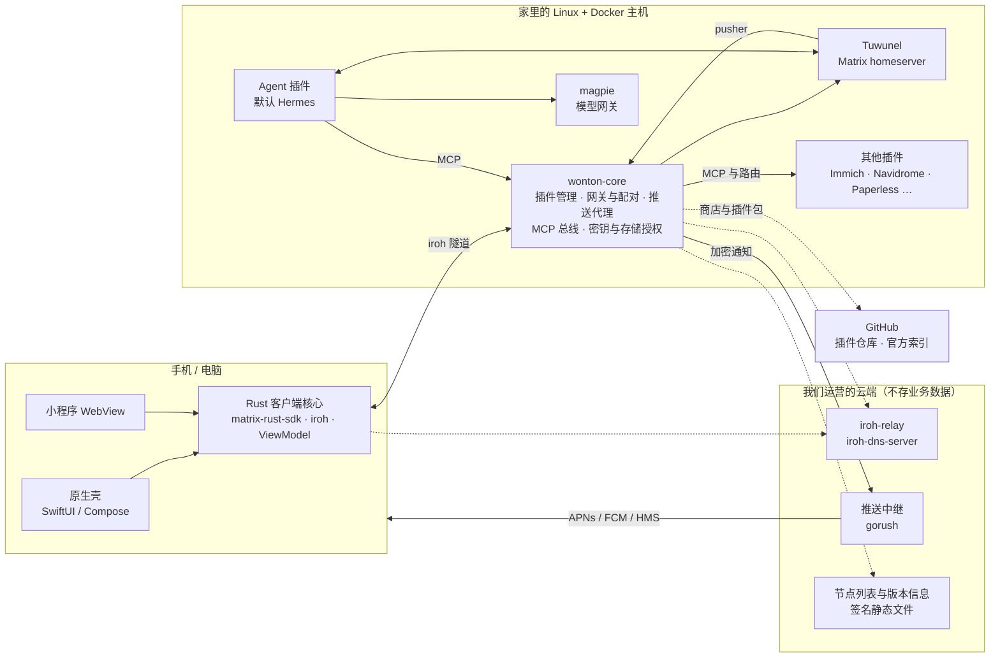

# 架构

本文描述 Wonton 的目标架构。每个选择的理由见对应的 [ADR](adr/README.md)。标注“M0 选型”或
“待验证”的部分，由 M0 技术验证给出结论后更新本文。

## 一句话

家里一台 Linux + Docker 主机上跑着一个薄的 Rust 核心容器，它用 Docker 管理所有插件；自托管的
Matrix 服务器（Tuwunel）是所有会话的事实源；Agent 和插件都以 Matrix bot 的身份和人对话；手机上的
原生 App 由一个厚的 Rust 客户端核心驱动，经 iroh 隧道连回家；推送经我们运营的中继转发密文。

## 组件总览



### 家里的服务器

| 容器 | 类型 | 职责 |
| --- | --- | --- |
| `wonton-core` | 核心 | 插件管理器（经 Docker API 安装、升级、启停、健康检查、日志）；网关与配对（iroh 入口、HTTP 反向代理、设备与用户、会话鉴权）；推送代理；MCP 总线；密钥库与存储授权。唯一挂载 Docker socket 的容器。 |
| `tusd` | 核心组件 | 设备上传文件的可续传接口（tus），只在核心的私有网络里，鉴权和编号由核心决定（ADR-0020）。 |
| `wonton-egress` | 核心组件（配了代理才有） | 出口容器：把出网插件的请求转给主人的代理（ADR-0023）。 |
| `tuwunel` | 系统插件 | Matrix homeserver，默认关闭联邦。会话、历史、多端同步、家人群聊的事实源。 |
| `hermes` | 默认插件（可替换） | 默认 Agent，以 Matrix bot 身份接入；一个 Hermes profile 对应一个 Bot。核心启动后自动装一次，主人卸掉就不再装（ADR-0007）。 |
| `magpie` | 系统插件（可替换） | 模型网关：provider 和 key 只配一次，所有插件共用。 |
| 其他 | 可选插件 | Immich、Navidrome、Paperless-ngx、Ollama、Syncthing、Samba，以及任意 CasaOS 应用。 |
| `wonton-updater` | 一次性容器 | 升级核心时拉起：拉新镜像、重建核心、健康检查，失败回滚。 |

### 云端

我们只运营转发类服务，没有用户账号，也不存业务数据。

| 服务 | 选型 | 说明 |
| --- | --- | --- |
| 中继 | 官方 `iroh-relay` 镜像 | 打洞失败时转发隧道流量。共享令牌加限速。 |
| 发现 | 官方 `iroh-dns-server` 镜像 | 家里服务器换网络后，App 靠它找到新地址。 |
| 推送中继 | gorush 加一层鉴权 | 只接收密文，转发到 APNs、FCM、华为 HMS。 |
| 目录 | 签名静态文件 | 中继节点列表、核心版本信息。插件的官方索引在 GitHub 上，签名以后也能经这里分发（ADR-0017）。 |
| 镜像 | GHCR 加国内镜像仓库 | 安装脚本按网络选择。 |

开发和 MVP 内测期，中继和发现先用 n0 的公共节点，推送中继从 M2 起部署在我们的一台公网主机上；
自建中继和发现节点在 M2 部署（香港和海外各一个起），公司主体和备案办好后再加内地节点。

### 客户端

| 端 | 技术 | 说明 |
| --- | --- | --- |
| iOS | SwiftUI | 外加通知扩展（解密推送）；录屏扩展留给 M2 的屏幕共享。 |
| Android | Jetpack Compose | 推送服务内本地解密；国内可选“保持连接”前台服务。 |
| 桌面（M2） | Compose Multiplatform | 与 Android 共享 UI 模块。 |
| Web（M3） | Compose 编译到 Web | 核心在服务器上运行，浏览器经 WebSocket 收发。 |
| 客户端核心 | Rust + UniFFI | matrix-rust-sdk、iroh、本地代理、状态、ViewModel、行为测试。 |

## 主要链路

### 安装与配对

1. 一行安装脚本拉起 `wonton-core` 和系统插件，并让用户选择存储目录。
2. 核心生成服务器的 iroh 身份。还没有配对的设备时，局域网状态页和安装终端显示首次配对码的二维码，码里有
   服务器 endpoint ID、中继和直连地址和一次性密钥（格式见 ADR-0009 的“接口：扫码配对”）。
3. App 扫码后经 iroh 连接核心、出示密钥。核心记下这台设备的 endpoint ID（QUIC 握手认证过的身份，以后只接受
   已配对设备），首次配对码随之作废。设备再经隧道要一次性的 Tuwunel 登录 JWT，用它自己登录（方案见 ADR-0009
   的验证结果）。
4. 之后 App 每次启动都经隧道连回；服务器换了网络，App 通过发现服务找到它。
5. 以后加设备，在已配对的 App 里点“添加设备”出码给新设备扫；设备都丢了，在服务器终端执行 `sudo wonton pair`。
   信任边界是服务器终端和已配对的设备，能接触局域网不算可信（理由见 ADR-0009）。

### 聊天

App 的 Matrix 客户端请求进入客户端核心的本地代理，经 iroh 隧道到核心网关，再转给 Tuwunel。
Bot（Agent 插件）作为 Matrix 用户收到消息，通过 magpie 调模型，通过 MCP 调工具，再把回复发回房间，
由 Sliding Sync 同步到所有设备。

### 推送

1. App 把平台给的推送地址和本机的推送公钥（Web Push 的推送订阅）经隧道登记给核心，并在 Tuwunel 注册指向核心
   推送代理的 pusher。
2. 有新消息时，Tuwunel 调用核心推送代理（Matrix Push Gateway 接口）。
3. 核心用该设备的公钥加密通知（房间、消息 ID 和发送者；聊天是端到端加密的，推送里没有正文），按 Web Push
   （RFC 8030、8291）发到推送地址。
4. 推送地址来自 UnifiedPush 分发器（如 ntfy），或者是我们的中继为 FCM、APNs、HMS 令牌开的；中继校验发送方服务器
   身份并限速，再转发。
5. App 在本机解开通知，经隧道取回这条消息、在本机解密后显示。中继和苹果、谷歌只看到密文。设计见
   [ADR-0003](adr/0003-matrix-and-encrypted-push.md) 的“设计：加密推送”。

### 小程序

App 打开插件网页时，WebView 以客户端核心的本地代理为 HTTP 代理（原样保留 `Host`），经隧道到核心网关。
本地代理只接受带本次会话凭据的连接，同机的其他 App 借用不了配对身份。核心在进程内服务隧道流，
把隧道认证的设备身份交给网关；网关认出主人的设备后，按插件清单把请求路由到插件容器，不需要 Cookie
会话（局域网浏览器仍用核心会话）。新插件默认用应用自带的登录（`sso: none`，ADR-0022），主人第一次打开时在
应用里注册管理员，网关保证只有主人打得开。声明 `sso: oidc` 时，核心在安装时为它注入 OIDC 客户端配置，用户
进入时自动登录（OIDC 提供方见选型表）；声明 `sso: proxy` 时，由网关代为带上用户名或应用自己的密钥。

### 插件安装

1. 来源：官方索引里审核过的插件、GitHub 上的社区插件（`github:<owner>/<repo>@<tag>`）、导入的 CasaOS 应用，
   或主人上传的插件包。每个插件一个仓库，发布就是打 tag（ADR-0017）。
2. 核心校验清单，生成权限清单。
3. 主人在 App 里确认权限；如果是 Bot 发起的安装，确认按钮出现在聊天里。
4. 核心准备插件要用的身份和凭据（Bot 账号与令牌、模型网关凭据、插件密钥、OIDC 客户端），渲染
   compose 时注入它们和应用数据目录、已授权的共享文件夹（变量见插件规范），并为插件建独立的
   Docker 网络：插件经核心访问模型网关和 Tuwunel，出网规则见插件规范。
5. 经 Docker API 启动，健康检查通过后注册网页路由和 MCP 端点，然后通知主人。

### Agent 调工具与确认

Agent 通过 MCP 调用核心 MCP 总线。总线按 Bot 的工具白名单放行。敏感操作（装卸插件、删文件、
改设置、对外发送）不会直接执行：核心以自己的账号在和主人的“Wonton”私聊里发一张确认卡片（结构化内容放在消息的
`app.wonton.confirmation` 字段，附纯文本兜底），主人在 App 里点确认（经隧道请求核心）后才执行，并写审计日志，
最后把结果返回给 Agent（ADR-0016）。主人可以调整插件工具的确认（ADR-0024）。

### 文件

核心提供文件服务：每个文件一个编号，指向共享文件夹里的原文件、插件的资源或设备上传的文件。工具结果里的文件，总线换成编号交给 Agent；Agent 分享后拿到一个
`wonton://file/<编号>` 链接，放进回复。App 认出链接显示成卡片，字节经隧道走 HTTP（下载用 `Range`，上传用 tus）。设备上传的文件放进共享文件夹 `transfers`，算主人自己的文件。App 之间互传用同一种链接（ADR-0020）。

### 升级

核心按渠道（stable / beta）从目录检查新版本并通知主人。主人确认后，核心拉起 `wonton-updater`：
拉新镜像、重建核心容器、健康检查，失败就回滚到旧镜像。插件按官方索引里的版本或仓库的新 tag 提示升级，主人确认后
只换容器，失败回滚（ADR-0017）。

## Bot 与 Agent

- Bot = 一个 Matrix 身份 + 一个驱动它的 Agent 插件。核心负责给 Bot 分配身份、权限、模型访问和工具，
  不和具体 Agent 耦合。
- 会说 Matrix 的 Agent 直接接入（Hermes 的 Matrix 平台）。支持 ACP 的 Agent（Codex、Claude Code、
  Gemini CLI、OpenCode 等）通过通用“ACP 桥”插件接入：一个聊天房间对应一个 ACP 会话，ACP 的权限
  请求对应聊天里的确认按钮。
- 每个家人有自己的私人 Bot；Bot 之间可以互发消息，规则见 [ADR-0007](adr/0007-agents-and-bots.md)。

## 安全模型

- Agent 是不可信执行者：独立容器，只看得到自己的工作区和被授权的文件夹，没有 Docker socket，
  也没有宿主 root。
- 插件权限写在清单里，安装时确认。高权限（host 网络、设备、GPU、Docker socket、特权模式）单独醒目确认。
  显卡由核心按宿主实际有的显卡交给清单指定的服务，插件写不了设备路径（ADR-0018）。
- provider key 等密钥只存在核心密钥库和 magpie，插件拿到的是受限令牌。
- 来自其他 Bot、网页、文件的内容都视为不可信输入。

## 仓库布局（规划）

```text
crates/
  wonton-protocol/   核心 API、ViewModel、插件清单类型：跨端唯一事实源，生成 Swift/Kotlin 类型
  wonton-tunnel/     iroh 隧道，服务端与客户端共用
  wonton-matrix/     Matrix 客户端封装（matrix-rust-sdk），供客户端核心使用
  wonton-core/       服务端核心
  wonton-client/     客户端厚核心，UniFFI 导出
apps/
  ios/               SwiftUI 壳、通知扩展
  compose/           Kotlin Multiplatform：共享 UI 模块、android、desktop（M2）
plugins/             核心测试用的示例插件；正式的插件各在自己的仓库（ADR-0017）
cloud/               中继、发现、推送中继、目录发布的部署配置
deploy/              一行安装脚本、compose 模板、升级器
docs/                文档
scripts/             CI 与开发脚本
```

## 选型

| 能力 | 选型 | 许可证 | 状态 |
| --- | --- | --- | --- |
| Matrix homeserver | Tuwunel | Apache-2.0 | 已定，M0 验证 |
| 客户端 Matrix SDK | matrix-rust-sdk | Apache-2.0 | 已定 |
| 隧道 | iroh 1.x（参考 dumbpipe） | MIT / Apache-2.0 | 已定 |
| 中继与发现 | iroh-relay、iroh-dns-server | MIT / Apache-2.0 | 已定 |
| 推送中继 | gorush（APNs、FCM、HMS） | MIT | 已定；小米、OPPO、vivo 在 M2 |
| Docker 管理 | bollard | Apache-2.0 | 已定 |
| 默认 Agent | Hermes Agent | MIT | 已定 |
| Agent 接入 | Matrix 原生、ACP | Apache-2.0（ACP 规范） | 已定 |
| 模型网关 | magpie | MIT | 已定 |
| MCP 总线 | 官方 Rust SDK rmcp，在核心里做最小聚合 | Apache-2.0 | 已定（ADR-0006），M1 实现 |
| 插件商店 | 插件仓库按 GitHub topic 发现，官方索引是一个仓库（参考 magpie） | — | 已定（ADR-0017） |
| OIDC 提供方 | Ory Hydra | Apache-2.0 | 已定（ADR-0009） |
| 可续传上传 | tus 1.0、tusd | MIT，独立容器 | 已定（ADR-0020） |
| 出口代理 | gost | MIT，独立容器 | 已定（ADR-0023） |
| HTTP 网关 | 核心内置（axum + hyper） | MIT | 已定（ADR-0006） |
| 客户端绑定 | UniFFI | MPL-2.0 | 已定 |
| UI | SwiftUI、Compose Multiplatform | — / Apache-2.0 | 已定 |
| 相册 | Immich（插件） | AGPL-3.0，独立容器 | 已定 |
| 文档 | Paperless-ngx（插件） | GPL-3.0，独立容器 | 已定 |
| 音乐 | Navidrome（插件）+ Subsonic 原生页（M2） | GPL-3.0，独立容器 | 已定 |
| 实时通话（M2） | LiveKit、MatrixRTC | Apache-2.0 | 预留 |

不使用：Element X、FluffyChat、Dart 版 Matrix SDK（AGPL）；Umbrel 应用商店（无开源许可证）。

## 预留扩展点

- **实时通话与屏幕共享（M2）**：通话是一通 MatrixRTC 通话，Agent 作为参与方加入。默认用云端实时
  模型直连（家里服务器签发临时令牌，工具调用回家执行）；隐私模式在家里跑 LiveKit 插件。客户端核心
  把音频会话和后台模式抽象一次，供音乐和通话共用。见 [ADR-0014](adr/0014-reserved-capabilities.md)。
- **小程序 JS SDK（M2）**：原生播放、文件选择、分享、发到聊天。
- **第三方 IM 渠道（M2）**：渠道插件，基于 Hermes 自带的平台或 mautrix 桥。
- **Web 端（M3）**：核心接口保持可序列化（操作进、ViewModel 出），为浏览器远程使用留路。
- **跨机 Bot 通信（M3）**：插件实现，Matrix 联邦走 iroh 或 A2A。
