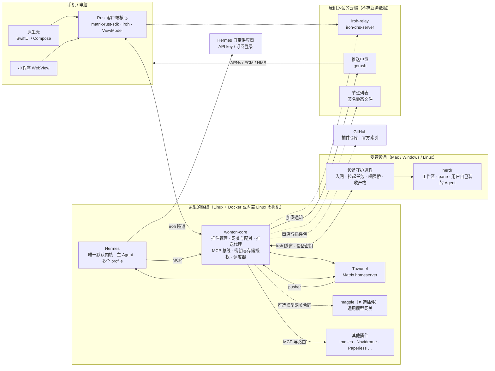

# 架构

本文描述 Wonton 的目标架构。每个选择的理由见对应的 [ADR](adr/README.md)。

## 一句话

家里一台常开的枢纽（Linux + Docker 主机，或者 Mac、Windows 上的内置 Linux 虚拟机）上跑着一个薄的 Rust 核心容器，它用 Docker
管理所有插件；其他电脑作为受管设备挂在枢纽下，在自己的工作区里跑 Agent。自托管的 Matrix 服务器（Tuwunel）是所有会话的事实源；
Agent 和插件都以 Matrix bot 的身份和人对话；手机上的原生 App 由一个厚的 Rust 客户端核心驱动，经 iroh 隧道连回家；推送经我们运营的中继转发密文。

## 组件总览



### 枢纽（家里的服务器）

| 容器 | 类型 | 职责 |
| --- | --- | --- |
| `wonton-core` | 核心 | 插件管理器（经 Docker API 安装、升级、启停、健康检查、日志；Docker Hub、ghcr、quay 的镜像可以经加速地址按摘要拉，按仓库分名单，ADR-0074）；网关与配对（iroh 入口、HTTP 反向代理、设备与用户、会话鉴权）；推送代理；MCP 总线；密钥库与存储授权；调度器（设备注册表、任务表、派活、产物核对）。系统服务里唯一挂载 Docker socket 的容器（升级器见下；声明了 `docker.socket` 的插件见 ADR-0036）。 |
| `tusd` | 核心组件 | 设备上传文件的可续传接口（tus），只在核心的私有网络里，鉴权和编号由核心决定（ADR-0020）。 |
| `wonton-egress` | 核心组件（配了代理才有） | 出口容器：把出网插件的请求转给主人的代理（ADR-0023），或者装着的代理插件（ADR-0039）。 |
| `tuwunel` | 核心组件 | Matrix homeserver，默认关闭联邦。会话、历史、多端同步、家人群聊的事实源。 |
| `hydra` | 核心组件 | OIDC 提供方，插件的单点登录（ADR-0009）。 |
| `mailpit` | 核心组件 | 收插件应用发的信（SMTP），接入申请了 `notify` 的插件网络，只收发给家里人的内部邮箱；核心取走后转进聊天（ADR-0056）。 |
| 第三方 App 入口 | 核心组件（有要服务的名字和证书才有） | 入口容器、局域网转发、连接器和 lego，由核心管理（ADR-0021）。名字来自装机设置或 App 里配的自己的域名，“不要名字”的装法也能只靠后者；证书签出来才建入口，续期按天跑、条款没勾不联系 CA。连接器是 TCP 转发、frpc 或 cloudflared，主人在设置里选，公网访问有总开关（ADR-0090）；lego 用主人的 DNS 服务商（ADR-0089）。 |
| `hermes` | 默认插件（可卸载） | 唯一默认 Agent，走原生 Matrix；各家人的私人 Bot、共享 Bot 保留独立身份与数据边界。核心按普通默认插件机制装一次，卸掉不重装；安装和运行不以 Magpie 为前置（ADR-0108）。 |
| `magpie` | 可选普通插件 | 通用模型网关；核心和默认装机不依赖它，不再承担 Agent 的模型入口。通用网关合同及其使用方的凭据与授权边界保留（ADR-0008、ADR-0108）。 |
| 其他 | 可选插件 | Immich、Navidrome、Paperless-ngx、Ollama、Syncthing、Samba 等。 |
| `wonton-updater` | 一次性容器 | 升级核心时拉起，用核心自己的镜像：拉新镜像、重建核心、健康检查，失败回滚（ADR-0025）。 |

### 受管设备

受管设备是挂在某个枢纽下的电脑（Mac、Windows、Linux），不跑核心、不跑 Tuwunel、不是 Matrix 用户。设备上只跑两样：
我们签名的设备守护进程（入网、拿任务、转发权限、收产物）和 herdr（一个任务一个工作区、一个 pane，跑用户自己装的 Agent）。
设备归属人批准工作区根；任务记录、会话、审批和产物核对都在枢纽。见 [ADR-0123](adr/0123-hubs-and-managed-devices.md)。

### 云端

没有用户账号，也不存业务数据。第三方 App 入口存的是运行它必需的数据，见 [ADR-0012](adr/0012-updates-release-cloud.md)。部署安排见 [GOAL](GOAL.md) 的 M2。

| 服务 | 选型 | 说明 |
| --- | --- | --- |
| 中继 | 官方 `iroh-relay` 镜像 | 打洞失败时转发隧道流量。准入只认 endpoint ID，见 ADR-0048。 |
| 发现 | 官方 `iroh-dns-server` 镜像 | 家里服务器换网络后，App 靠它找到新地址。 |
| 推送中继 | gorush 加一层鉴权 | 只接收密文，转发到 APNs、FCM、华为 HMS。 |
| 目录 | 签名静态文件 | 中继节点列表。插件的官方索引在 GitHub 上，签名以后也能经这里分发（ADR-0017）。 |
| 镜像 | GHCR 加国内镜像仓库 | 安装脚本按网络选择。 |
| 第三方 App 入口 | frps、家名服务、PowerDNS、acme-dns | 只按 SNI 或端口转发，不解密（ADR-0021）。 |

### 客户端

| 端 | 技术 | 说明 |
| --- | --- | --- |
| iOS | SwiftUI | 外加通知扩展（解密推送）；录屏扩展留给 M2 的屏幕共享。 |
| Android | Jetpack Compose | 默认“保持连接”前台服务；推送是设置里的高级选项：有谷歌服务走 FCM，其余用 UnifiedPush，一律在推送服务内本地解密（ADR-0003）。 |
| 桌面（M2） | Compose Multiplatform | 与 Android 共享 UI 模块。 |
| Web（M3） | Compose 编译到 Web | 核心在服务器上运行，浏览器经 WebSocket 收发。 |
| 客户端核心 | Rust + UniFFI | matrix-rust-sdk、iroh、本地代理、状态、ViewModel（含设置首页 `SettingsViewModel`）、行为测试；壳经一个 `ClientCore.dispatch(Action)` 入口提交按领域包装的操作。 |

界面文字在两端各自的本地化资源里，语言跟随系统，也能按平台惯例单独设置；客户端核心只给类别和原始值，App 的语言经 `Accept-Language` 带给家里的服务器和插件页（ADR-0043）。服务器把语言按人记下，插件经 OIDC 的 `locale` 声明和核心 MCP 的 `wonton__user_locale` 工具按人取，默认语言由插件自己定。

客户端核心的“详情”用 `crates/wonton-client/locales` 的 Fluent 目录写，按 `SetLanguages` 第一项（App 在用的语言）协商，不支持的退到英文；一次请求用开始时的语言，日志用英文。连接失败的 `HomeStatus.message`、`ConnectionDetails.last_failure` 和配对失败说明只含本地化原因；原始错误及配对连接地址放进各自的可选 `diagnostic`，壳提供独立、默认收起且可复制的诊断入口。配对详情的实际总耗时与每个交换阶段的限时分别用秒表示，不把阶段限时当作整次耗时。其他详情保留上游原文和错误码。`CoreError` 的字段不变，前缀由客户端注册给协议 crate 的格式化函数按语言生成，不增加 UniFFI 类型。客户端和服务器共用 `wonton-l10n`（目录、CLDR 协商、一致性检查），资源和当前语言各自持有。

系统入口（桌面小组件、系统搜索、iOS 控制按钮）不跑客户端核心：核心把当前服务器的最近会话、默认 Agent、联系人和插件投影成
`wonton-protocol::widget` 的快照，写到数据目录下的 `widget/snapshot.json`（iOS 在 App Group 容器里），入口只读这份文件渲染，
点了经 `wonton://` 链接进 App（ADR-0100）。

iPad regular 宽度与 Android expanded 宽度使用“会话列表 + 当前内容”两栏；插件页只铺内容栏，窄屏保留单列和侧边栏抽屉。
房间选择与导航路径属于窗口的壳内状态，尺寸变化只换布局、不替主人选择房间；插件页面栈仍由客户端核心维护。
布局与内容窗口的边界见 [ADR-0103](adr/0103-ipad-and-large-screens.md)。
iPad 内容窗口共享进程内的 `ClientCore`，不复制主页面栈。每份时间线订阅独立保活房间、保存滚动回执，
最后一份订阅释放后撤销房间 watch；房间面板按房间路由。独立插件页通过 `subscribe_content_page` 保活，
`PlacedTab::Content` 复用页面解析、权限与桥，加载状态与主栈同页共享，WebView 和场景滚动位置各自独立。
端口自动映射取主页面与内容页的可见集合，最后一个页面关闭才释放；应用前后台与网络变化由进程级监听上报。

主界面是 Agent、应用两个平级根页，下面一条默认两项、用户可增删排序的底栏（[ADR-0126](adr/0126-agent-list-bar-and-cloud.md)）。当前页、底栏的
成员和顺序、收件箱的待回答数都在客户端核心的 `PagesViewModel` 与 `BarViewModel` 里，壳按它画；应用页压栈后不画底栏。收件箱按
[ADR-0119](adr/0119-pending-inbox.md) 的条目进收件箱页，铃铛只给待回答数；晨报等 Hermes 的产出接入前留空不放假数据。

账号槽位既可以是配对的 Wonton，也可以是外部 Matrix 账号；导航条目和应用页操作由客户端核心给出，
壳不按槽位种类自行隐藏。好友身份、插件分享和 OpenID 连接的边界见 [ADR-0051](adr/0051-friends-and-plugin-sharing.md)；
其接口契约在 `wonton-protocol` 的 `friends`、`sharing`、`share_transport`、`matrix_login` 模块。

分享页的身份是 `TabRef::SharedApp { owner_user_id, plugin_id }`，与本机插件及其他来源的同名插件隔离。
同一来源的网页共用 `SharedAppsSource.state` 在 `Ready` 中提供的本地代理；连接结束便撤下代理，保留的旧列表不代表授权。
两端沿用插件页面容器与主题、语言桥，保留分享方的 `web_url`，不借用自家 `HomeViewModel` 的代理。

设置「我的应用」中的插件行打开既有插件详情，非插件行不提供此入口。家人按角色开放的范围与好友逐项分享仍使用详情里的既有控件；
授权状态和分享人数由核心提供，在详情中显示，列表行上的分享提示不表示已经授权。

插件详情页的主人密钥由 `ListOwnerSecrets` 展开后列出，`ShowOwnerSecret` 才向服务器取一项值。
`PluginsViewModel.owner_secrets` 只保留展开中的临时显示状态，不写入缓存；收起、离页、进入后台或换服务器时清除，
晚到的请求不能重新显示。再次展开重新取列表和值，复制由原生壳使用系统剪贴板完成。

服务端 `friends` 模块持有 `core/friends.json`：Matrix 好友、本机插件用户名、各自的角色（ADR-0088）及最后打开分享时间。
Matrix 邀请流程只在对方同意后调用存储 API；本机账号分配须同时保留好友墓碑里的用户名，避免和插件账号混淆。
授权消费者先订阅完整快照再校验，连接与授权绑定 `access_generation`；删好友再加回不能恢复旧连接。
出站邀请按邀请人的“加好友”权限项在网关的 Matrix 代理处判断，能发出邀请的写法都算（`/invite`、`createRoom` 的 `invite`
和 `initial_state` 成员事件、`state/m.room.member` 的 invite）：家里人不受限，`AskAdmin` 记管理员卡片并挂住请求。
被邀请的人和落地页的发起人都要是一个具体的 Matrix 用户 ID（`allowed_users` 按通配匹配，带 `*`、`?` 的不收），否则 400、不开卡。
同意后在 `member_sync` 锁里复核设备归属和当前角色，仍要批才把这次获批的人写进邀请人的 `allowed_users`，写不进去
不发出、回 503；拒绝和过期分别回 403、408（ADR-0088 第 3 节）。家外先发来的邀请在 Tuwunel 就被挡住、核心看不到，
所以服务器名上另有一个公开落地页（`/_wonton/friend-request`，也认根路径）收请求：填发起人和对方，开同一张管理员卡片，
批准后同样写 `allowed_users`，对方重发邀请即可；同服务器的人和角色已放开的人不用交请求。结果按真实原因回给页面，
待批条数有上限，结果只存内存。
服务端另有一组分享组件：`friends` 存好友和固定用户名，`shares` 存授权，`share_identity` 按 Matrix 服务器名认人，
`gateway::sharing` 校验每次请求并在授权失效时拆掉长连接，`wonton-tunnel::sharing` 是 `wonton/share/0` 的两端。
分享只能发对方角色 `open_apps` 范围里的应用，越界回 400；角色改了，授权立刻按新范围生效，不用重建连接。
`wonton/share/0` 连接经 OpenID 认证后只拿到授权里的插件；认证前不转发任何网页请求。好友打开网页时由网关按
`{user}`（固定用户名）、`{name}`、`{role}=user` 填身份，`sso: oidc` 只发 `groups=["user"]`。

## 主要链路

### 安装与配对

1. 一行安装脚本拉起 `wonton-core` 与核心组件，并让用户选择存储目录；默认 Hermes 沿用核心的普通默认插件安装机制，不先装 Magpie 或等待网关凭据（ADR-0108）。
2. 核心生成服务器的 iroh 身份。还没有配对的设备时，局域网状态页和安装终端显示首次配对码的二维码，码里有
   服务器 endpoint ID、中继和直连地址和一次性密钥（格式见 ADR-0009 的“接口：扫码配对”）。
3. App 扫码后经 iroh 连接核心、出示密钥。核心记下这台设备的 endpoint ID（QUIC 握手认证过的身份，以后只接受
   已配对设备），首次配对码随之作废。设备再经隧道要一次性的 Tuwunel 登录 JWT，用它自己登录（方案见 ADR-0009
   的验证结果）。
4. 之后 App 每次启动都经隧道连回；服务器换了网络，App 通过发现服务找到它。
5. 以后加设备，在已配对的 App 里点“添加设备”出码给新设备扫；设备都丢了，在服务器终端执行 `sudo wonton pair`。
   信任边界是服务器终端和已配对的设备，能接触局域网不算可信（理由见 ADR-0009）。
6. 显示名和邮箱在 App 里填，存在核心里，单点登录从那里取显示名（ADR-0030）；资料里的头像就是 Matrix 上这个人的 `avatar_url`，换头像由客户端把自己的会话传文件、写好这个字段，核心只读服务器上的那份。插件拿到的邮箱是每人一个、不变的内部邮箱，应用发来的信进这个人的待处理面板（ADR-0056、ADR-0119）。

### 新用户引导

服务器比 App 旧时，引导不整页报错：某个接口回 404、而服务器报的版本比这个接口要的旧（`minimum_server_version`），客户端核心归成“服务器太旧”，这一步整步不显示、完成时也不做它；连引导接口都没有时整段不出现，只留一条升级服务器的提示。服务器不旧却回 404 的照旧按原类别报。服务器版本从核心升级状态的 `current.version` 取，取不到就不判旧。

默认助手只用 Hermes，引导不再要求选择内核、Agent 或安装 Magpie：默认 Bot 由默认插件目录里唯一的 Agent 插件重建，模型页只有“沿用当前模型”和打开上游设置页。资料、应用推荐、安装权限和本地帮助的职责沿用 ADR-0034；内核选择、经桥订阅登录和固定 Magpie 模型页面的规则由 [ADR-0108](adr/0108-hermes-default-kernel.md) 取代。

模型接入使用 Hermes 自带供应商与其原生登录、配置能力，不另建 Wonton provider 或登录适配。未配置、登录失效、上游失败和可用必须区分，不能以打开过页面代替真实模型可用；本篇不决定引导顺序、导航或控件。

### 帮助文档

用户问 Wonton 和 App 的用法时，Agent 调核心的 `wonton__help`。文档在公开仓库 wonton-docs 的 `user/`，核心镜像带一份，有网时按官方索引记的提交取新版，核对 sha256 后存盘。Agent 插件自带一个指路的 skill，文档只有核心这一份。设计见 ADR-0034。

### 聊天

App 的 Matrix 客户端请求进入客户端核心的本地代理，经 iroh 隧道到核心网关，再转给 Tuwunel。

打开 App 先用本机存下的会话：本机有这台服务器的登录状态就立刻恢复，房间和已有历史从本机出，不等隧道；请求连不上时状态如实显示“传输不可用”，同步自己退避重试，隧道通了再经本地代理接着同步。首次登录才等本地代理就绪。

Hermes 以对应 Bot 的 Matrix 身份收到消息，通过上游自带的供应商接入调模型、经 Wonton MCP 总线调受管工具，再把回复发回房间，由 Sliding Sync 同步到所有设备。模型接入和原生委派的边界见 [ADR-0108](adr/0108-hermes-default-kernel.md)。

Bot 的请求按令牌认是哪个 Bot，只有 whoami 说令牌不认（401 和 403 都算，后者是账号停用之类的真失效）才回 403；核心还在恢复插件、或问不到 Tuwunel 时回带 `Retry-After` 的 503，让上游的重试活下来（[ADR-0111](adr/0111-bot-request-retryable-restart.md)）。网关顺手记下每次成功的同步，插件的健康检查超过 120 秒没同步就标 `Degraded` 并写明原因：上游的 `/health/detailed` 只看平台状态，同步循环停了也报 connected。

Agent 私聊里的插件未就绪提示由客户端核心从插件列表与本设备的启动请求合成：停止、启动中和按类别的启动失败分开显示，
只在停止且没有启动请求进行中时提供启动动作。启动后重新读取服务器列表，不以按钮点击或启动响应伪造运行状态；
确认运行后撤下提示。我的应用和启动器也标出停止。插件停止不改变 Matrix 房间的发送权限：消息仍可发出，但 Agent 启动后才能回复。

输入框里选的照片和文件先进附件区预上传；一次发送里的附件全部传完、文件授权给房间以后才发第一条事件，几条事件带同一个分组标记，
主人的字在最后一条上，Bot 按标记收齐再开一轮（[ADR-0094](adr/0094-chat-attachments.md)）。
从系统分享面板分享进来的照片、文件和文字由壳放进数据目录的收件目录（iOS 由分享扩展写进 App Group），核心认领后出分享页，
主人选好聊天点发送，作为一条待发消息走同一套发送（[ADR-0097](adr/0097-share-in.md)）。

跨服务器发起私聊失败时，“对方服务器还没配对”和“对方服务器的公网访问关着”是两个 `ChatFailure` 类别，壳分别提示先去配对和稍后再发
（[ADR-0050](adr/0050-cross-server-chat.md)、[ADR-0090](adr/0090-public-access.md)）；两者都不能并成“没有权限”。类别和两端的提示已就位，
核心还没产出这两个类别，跨服务器失败仍按 Matrix 原文归进别的类别，由 C5 接。

### 推送

1. App 把平台给的推送地址和本机的推送公钥（Web Push 的推送订阅）经隧道登记给核心，并在 Tuwunel 注册指向核心
   推送代理的 pusher。
2. 有新消息时，Tuwunel 调用核心推送代理（Matrix Push Gateway 接口）。
3. 核心按 pushkey 找到设备，把服务器 ID、房间、消息 ID、发送者、房间名和正文（不加密房间的完整格式里带着，附件只有类型和文件名）
   一起，按 RFC 8291 用该设备的公钥加密，按 RFC 8030 发到推送地址。明文总预算 3 KiB，套 JSON 的渠道（APNs、FCM、HMS）
   再收紧到 2 KiB；截断、丢字段的顺序和 pusher 的 `format` 见 [ADR-0118](adr/0118-im-three-layers-push-with-body.md) §2。
4. 推送地址来自 UnifiedPush 分发器（如 ntfy），或者是我们的中继为 FCM、APNs、HMS 令牌开的；中继校验发送方服务器
   身份并限速，再转发。
5. App 在本机解开就直接显示正文：Android 在推送服务里，iOS 在通知扩展里用 CryptoKit 解完改写通知。加密房间（别的客户端建的）
   没有正文，经隧道取回本条消息后补上，取不到就照实说原因。中继、推送服务、苹果、谷歌都只看得到密文。
   系统直接展示、应用解不了的渠道（小米、OPPO、vivo、HMS 的退回）只写“新消息”，点开再取。设计见
   [ADR-0118](adr/0118-im-three-layers-push-with-body.md) 和 [ADR-0003](adr/0003-matrix-and-encrypted-push.md) 的“设计：加密推送”。
6. 通知上直接回消息、答没有表单的确认卡片：动作回到核心现有的发送和回答路径，进程被系统收走也能重新拉起核心。
   未读总数由核心给，壳写成启动器角标；等确认的长任务挂一条常驻通知；锁屏上给不给看内容按类别在设置里选（ADR-0101）。
7. 要主人决定的事和要主人知道的通知（问题卡、页面/报告、收尾、确认卡片、插件通知、应用来信、请求、告警）由核心的收件箱统一显示，
   不再发进 Wonton 私聊；条目在核心里，壳只渲染（[ADR-0119](adr/0119-pending-inbox.md)，已接受）。

### 小程序

App 打开插件网页时，WebView 以客户端核心的本地代理为 HTTP 代理（原样保留 `Host`），经隧道到核心网关。
本地代理只接受带本次会话凭据的连接，同机的其他 App 借用不了配对身份。Android WebView 给不了跨源隔离，要它的页面交给系统浏览器，
经客户端核心在回环上开的浏览器入口进同一个本地代理，入口按主机名里的秘密标签认请求（ADR-0033 的“跨源隔离”）。核心在进程内服务隧道流，
把隧道认证的设备身份交给网关；网关按设备登记表认出这台设备的人（主人和家人，ADR-0045），按插件清单把请求路由到插件容器，不需要 Cookie
会话（局域网浏览器仍用核心会话）。新插件默认用应用自带的登录（`sso: none`，ADR-0022），主人第一次打开时在
应用里注册管理员；插件列表、详情和网页按当前角色的 `open_apps` 判断，主人不受限制（[ADR-0088](adr/0088-family-accounts.md)）。声明 `sso: oidc` 时，核心在安装时为它注入 OIDC 客户端配置，用户
进入时自动登录，身份是当前这个人（主人和家人各有账号）；`groups` 只有通用的 `user`，在这个应用里当管理员的人
加 `plugin_admin` 和清单的 `admin_groups`，清单声明了 `role_claim` 就按管理员与否填对应的值。声明 `sso: proxy` 时，
由网关代为带上当前人的用户名或应用自己的密钥，`{role}` 只有 `admin` 和 `user` 两种，网关同时注入 `X-Wonton-Capabilities`
能力头，页面自己带的同名头先删掉（ADR-0088 第 8 节）。认出人并过了 `open_apps` 的请求另带 `X-Wonton-Web-User`，
值是当前这个人的 Matrix 用户 ID，普通页和 Bot 页一样，客户端的同名头先删掉；插件自己网络里的直转、没登录、没授权和 OIDC 回调不带。
好友经分享连接打开共享页时也带，值是好友自己，按分享授权判，不看 `open_apps`。
只有经网关的请求有，插件把网页端口曝到宿主上时可以伪造（[ADR-0045](adr/0045-family-members.md#网页里的说话人)）。

每 Bot 网页不改清单：`webui.service` 属于 `bots.services` 时，每个 Bot 一份 UI 和独立 origin。
默认 Bot 沿用插件 slug；非默认 Bot 用 `bot--<Bot 名>-<截短的插件 slug>-<8 位 SHA-256 十六进制摘要>`，
只截 slug，不截 Bot 名，标签最多 63 字节；在现有分配锁下先检查并预留主机标签，再创建 Matrix 身份、凭据、
数据目录或容器，撞名回 409 且不产生这些部分副作用，不改名或回退默认 Bot；崩溃恢复不承诺跨系统回滚。
入口仍原样追加 `webui.path`，精确命名算法见插件规范，不从主机名反推 Bot 身份。
Bot 服务的 `WONTON_APP_URL`、OIDC 回调登记和精确主机 Cookie 跟随对应 origin，不设父域 Cookie。
网页复用插件级的 `open_apps` 授权，不按 Bot 归属或聊天参与者另行放行；好友沿用已支持的插件分享授权。
聊天资格和网页授权分开算：核心按请求者、Bot 归属和已成立的联系人算出 `BotChatAvailability`
（本人的、角色允许的共享 Bot、已成立联系人可用；别人的私人 Bot 里从没授权、等同意的算“没授权”，
拒绝过、对方已不存在的算“授权已撤”；读不明为未知）。
`open_apps` 只决定网页，不证明任何私人 Bot 能聊。同一份结果喂默认 Bot 字段、活动快照（不能用的人的计数清零）、
新建聊天候选和侧栏；旧私聊、固定项和深链接都不清房间、不换 Bot，房间行带原因，App 只在确定不能用时禁用输入框
并写一句为什么，未知（离线、旧核心）照常发进离线队列，普通 Matrix 发送不在服务器层拦。
开放的是同一个 Bot 的应用及登录入口，家人可能读取、修改同一应用状态；是否按人隔离由上游账号模型决定，
共用会话凭据时须明确提示共用登录状态，不把多用户应用一概视为同一个登录。
Agent／插件网络来源在 `self_request` 例外前拒绝；默认与非默认 Bot 主机名仍在自己的插件网络解析到网关，
容器内 `curl "$WONTON_APP_URL"` 的目标行为改为 403 `permission_denied`，不是 DNS 失败。
同插件网络容器仍可直连彼此端口，网关不提供这条路上的沙箱；不增加局域网端口或宿主权限。
家人登录前由四语言壳资源说明服务器主人可以查看、管理登录状态。
完整规则和错误类别见 [ADR-0045](adr/0045-family-members.md#插件网页和工具)；
[`bot_web` 协议](../crates/wonton-protocol/src/bot_web.rs)区分 Bot 页身份、可用性和失败原因。
Bot 页使用 `TabRef::Bot { bot: BotRef, path: Option<String> }`，不保存 URL，不降为插件页或公网网页。
`None` 路径打开对应 `BotView.web.Ready.page.url`，`Some(path)` 仅允许同 origin 内的路径（含查询和片段）；
打开沿用 `PageAction::OpenPage`，加入沿用 `PageAction::AddMyApp`、`PageAction::PinCurrentPage` 和面板，`PlacedTab` 保留同一 Bot 身份及路径。
聊天已有的 `BotView` watch 通道接入 `PagesLink`，网页状态变化时重算 `PagesViewModel` 的 `TabPage`；
URL 只来自精确匹配该 `BotRef` 的 Ready 页面，不读 `plugin.web_url`，桥和媒体以 `TabPage.url` 的精确 origin 为准。
`BotView.web: None` 没有验证可用的 URL；未知、缺失或错误时不发页面 URL，断连或身份变化时清空，不猜 URL 或回退默认 Bot。
资料页要显示地址、决定有没有入口，读和 `web` 同时写的 `BotView.web_page`（只在属于这个 Bot 的 Ready 页面时非空），壳不自己解析 `web`。
Bot 页复用既有页面容器、桥、媒体和 `--wonton-*`，不另造壳层 WebView、不省略桥。

插件整体异常时网关按服务看：清单 `webui` 指向的服务现在能用（容器在运行、健康检查没失败）就照常转发，网页里
依赖坏掉的部分由应用自己报错，插件在列表里照旧是异常（原因列出坏掉的容器和它的探针）；它停了或不健康、插件在
装、卸、升级、停止时才回 503 并写明原因。核心重启后核对也是逐个服务算的：一个容器没起来不影响别的服务的入口，
MCP 服务和模型网关同一条规则，局域网端口本来就直连各自的容器。

插件网页整页打开，网页框从状态栏下沿开始、壳不放控件，左边缘右滑或系统返回退出（ADR-0095），主题令牌由 App 注入，页面和 App 之间用 MCP Apps 的方法名。Agent 能写插件
并经总线装上，走和上传相同的校验和确认。设计见 [ADR-0033](adr/0033-plugin-tabs.md)。

### 第三方 App、局域网端口和出网

三条不经隧道的路，都要清单声明：第三方 App、外部回调和访客链接经公网子域名或局域网直连到入口容器（ADR-0021、ADR-0090）；插件把清单列出的端口发布到
局域网（`network.lan`，ADR-0019），网页端口要主人打开 `lan_webui`（ADR-0023）；出网插件经出口容器走主人的代理或代理插件（ADR-0023、ADR-0039）。
入口按 SNI 和 `Host` 分前端；前端在转发前盖 `X-Wonton-Entry` 标记（取前端名），核心据此区分来源。公网、局域网两个前端整体交给核心；经 iroh 进来的已配对服务器走配对前端，只有联邦、key 和三个发现文件交给核心，其余客户端 API 直给 Tuwunel（ADR-0051）。
宿主网络的插件按 ADR-0036 由核心配中继，网页和 MCP 经插件数据目录里的 unix 套接字进网关和总线，宿主防火墙不用改。
插件之间按能力依赖，使用方连 `<能力>.wonton.internal`，由核心按确认记录转发给选用的提供方：HTTP 能力经网关（ADR-0053），
`mqtt` 这类 TCP 能力经核心的四层中继（ADR-0092）。插件网络之间不互通。

### 插件安装

1. 来源：官方索引、GitHub 上的社区插件、主人添加的仓库、第三方索引、上传的插件包（ADR-0031），或 Bot 写好的插件包
   （ADR-0033）。插件包是仓库根目录或其中一个子目录：官方插件集中在 `wontonapp/wonton-plugins`，每个插件一个子目录；第三方
   插件仍一个插件一个仓库。发布就是打 tag，子目录插件用 `<子目录>/v<版本>`（ADR-0017、ADR-0079）。
2. 核心校验清单，生成权限清单和组件清单（来源、镜像摘要、工具、技能、连到哪里、碰哪些目录），只写标签的镜像这时解析成摘要并固定。
   形态有容器、静态网页、远端 MCP 和外部网页（书签）四种，技能是随包的负载（[ADR-0127](adr/0127-plugin-forms-and-install-trust.md)）。
3. 装卸按发起人角色的“装、删、升级应用”一项判断（ADR-0088）：允许的直接进行；设为“要管理员批”时
   核心把开卡时有管理成员权限的所有管理员（包括主人）加入冻结收件人，所有管理员设备都收到卡片，谁先同意都算数；
   一人回答后其他设备仍能看到带回答者用户 ID 的“已处理”结果，再回答回 409 `not_yours`。设备断开也不影响已批准的安装，拒绝回 403、过期回 408；
   开卡时一个收件人都没有设备则如实回 503 `confirmation_unavailable`。不能装的人请求返回 403 并写明缺的是哪一项。
   卡片只写得出预览里的包和权限，所以“要管理员批”的请求发卡前先核对：摘要和门槛的预览不一致回 409 `changed`，执行按同一个摘要取包；
   要打开可选权限、局域网开关，或升级时改选的设备、覆盖已有的密钥和设置、把主人关着的可选项升成必需（卡片写不出，只有主人和设为“允许”的人能改，ADR-0057），
   回 403 `permission_required{owner}`；预览装不了（`blocked`）按类别停下。三种都不发卡。卡片的版本行只在官方索引审核过的包上写“来自官方索引”，
   其他来源由未审核提示写明（上传的包、核心核实过的提供方和第三方索引），写出成员挑的设备、填的设置值和密钥名、
   一起装的提供方（同 Agent 卡片），选了 NVMe 或生效的权限里有最高级时多一张第二张卡（ADR-0036）。升级卡片挂着时主人改了这个插件的
   权限、局域网开关、设备、设置或密钥，批准后不执行，回 409 `changed`。确认权限的页面随请求带开放范围：哪些角色能打开这个应用
   （“全部应用”的角色自动在内、不可取消），装好后主人可在应用详情里改（只收主人）。
4. 如果是 Bot 发起的安装，确认按钮出现在聊天里，卡片的批准同样按 Bot 归属人的这一项判断。Bot 的更新沿用可选权限的开关，
   按执行时读到的记录算：卡片挂着时主人关掉的项，批准后仍关着。
5. 核心按清单准备所需身份和凭据（Bot 账号与令牌、声明使用模型网关时的受限凭据、插件密钥、OIDC 客户端），渲染
   compose 时注入它们和应用数据目录、已授权的共享文件夹（变量见插件规范），并为插件建独立的
   Docker 网络。Tuwunel 和声明使用的通用模型网关经核心访问；Hermes 的供应商接入归上游，出网规则见插件规范。
6. 经 Docker API 启动，健康检查通过后注册网页路由和 MCP 端点，然后通知主人。
7. 启动或健康检查失败时核心回滚并短时保留失败条目，条目带失败原因但没有网页入口，不满足“已安装”或页面自动加入条件；重试、卸载或核心重启后清掉。客户端不能把它伪装成成功：iOS 在启动器和“我的应用”标出失败，详情页显示原因并按权限提供重试、卸载或重新选择插件文件。

同插件服务可用 Compose 的 `network_mode: service:<服务>` 共用网络命名空间，目标必须使用插件网络且与共用者属于同一
Bot 组。网页、MCP 和局域网端口登记在目标上；核心等目标运行后再建共用者，重建目标时一起换掉共用者，避免 Docker 的
`container:` 模式继续绑定旧容器 ID。网页可按 Bot 指向同组目标，MCP 和能力提供方仍只用全插件一份的服务。

镜像由 Docker 守护进程拉取，不经插件的出口容器。主人打开镜像加速后，核心只把 Docker Hub、ghcr.io、quay.io 上按摘要固定的引用
按各仓库的名单顺序改到加速地址，一个站拉不下来就换下一个；由 Docker 校验内容，并在本地核对 `RepoDigests`。全都失败直接报错，
写明试过哪几个站，不退回直连。名单来自官方索引，Docker Hub 的还能手填，不改宿主 Docker 配置。
核心启动后和主人测速时检测 Docker Hub 直连，只推荐、不自动打开；Docker 守护进程自己配了 HTTPS 代理时不测直连，也不推荐。

### Agent 调工具与确认

Agent 通过 MCP 调用核心 MCP 总线。总线按 Bot 放行：主人对某个 Bot 单独关掉的插件，这个 Bot 看不到、调不了它的工具
（[ADR-0066](adr/0066-plugin-forms.md) 第 5 节）。远端 MCP 的工具装好后变了，在主人看过之前退回每次问（[ADR-0127](adr/0127-plugin-forms-and-install-trust.md) 第 5 节）。每个调用还按发起人角色的“AI 动手”级别封顶：只读角色只能看到并调用标了
`readOnlyHint: true` 的插件工具；“删除要管理员批”时会改工具的卡片给归属人，会删或覆盖的卡片给管理员；“改动自己确认”
照常确认并可按 ADR-0024 放宽。共享 Bot 有进行中的轮次时按其中最低级别。Agent 没说替谁办事（没带说话人请求头、这个 Bot 也没有进行中的轮次）时一律按只读，
不按归属人、也不按能用它的人里最低：说不出替谁办事就拿到归属人（主人的 Bot 就是主人）的权限，等于身份升级
（[ADR-0088](adr/0088-family-accounts.md) 第 5 节）。查不到人或角色按最严的只读处理并记日志。
说话人是本机另一个 Bot 的账号时，按它所在链的发起人封顶（ADR-0061 第 10 节），不按 Bot 账号本身，认不出它所在的链按只读。
Bot 的容器按 Bot 注入 `WONTON_BOT_AI_LEVEL`（单 Bot 的插件在插件级变量里，值是主人的“改动自己确认”）：私人 Bot 是归属人角色的级别，
共享 Bot 是能用人里最低的；Agent 插件按上游能力落实这项限制，核心总线仍独立校验，不把上游审批当作 Wonton 授权。
工具调用转给插件时，私人 Bot 的 `_meta` 带归属人的
`app.wonton/user` 和他在这个应用里的能力 `app.wonton/capabilities`（主人或“在这个应用里当管理员”的人是
`["plugin_admin"]`）；共享 Bot 和界面的调用不带人也不带能力，插件按全家共用的数据处理
（[ADR-0088](adr/0088-family-accounts.md) 第 8 节）。敏感操作（装卸插件、删文件、改设置、对外发送）不会直接执行：核心记下一张确认卡片并按收件人推送（归属人，或按上面级别给管理员），App 把它显示在发起的会话里和“等你确认”列表里
（卡片不进 Matrix 房间，来源会话由 Agent 一侧报、核心核对），主人在 App 里点确认（经隧道请求核心）后才执行，并写审计日志，
一轮里开出的卡片认在这条链上（按调用头的 `wonton-session`，没带时按这个 Bot 最近活着、报的又是同一个人的那一轮，说话人认不出时在候选里不按人过滤，
认不出就不认）：主人停掉这一轮，卡片随之撤回，等着的一方拿到 `cancelled`，批准了也不再执行。Agent 有事要主人定时，在 Bot 私聊里用文字问（ADR-0038）。

Wonton 受管资源仍由核心确认，主人设定的自动放行范围不变；Agent 容器内自身工具与原生委派按上游审批，须说明能读取本 Bot 数据和凭据的风险，不宣称所有动作均由核心逐步审批。受控发送保留收件人、全文确认、来源身份与实际投递回报，不能用 Hermes 裸发送替代（ADR-0108）。

Bot 用 `wonton__get_profile`、`wonton__set_profile` 读写自己的资料，无需确认；名字规则、头像检查和每小时成功次数上限由核心统一执行，见 [ADR-0044](adr/0044-bot-profile-and-status-avatars.md)。

### 文件

核心提供文件服务：每个文件一个编号，指向共享文件夹里的原文件、插件的资源或设备上传的文件。工具结果里的文件，总线换成编号交给 Agent；Agent 分享后拿到一个
`wonton://file/<编号>` 链接，放进回复。App 认出链接显示成卡片，字节经隧道走 HTTP（下载用 `Range`，上传用 tus）。
设备上传放进上传者的 `core/home/<用户名>/transfers`，不放共享文件夹；文件信息、内容、缩略图和操作都核对访问者，
主人也不能读取成员未分享给自己的文件。App 之间互传仍用同一种链接，并发进这个人自己的待处理面板（ADR-0045、ADR-0119）。

### 链接预览

聊天里的链接卡片由家里的核心去取：主人和家人的设备经隧道 `GET /_wonton/api/link-preview?url=`，核心自己解析域名、拒绝内网地址，经主人的出网代理
（没配就直连）取网页开头和 `og:image`，结果连同图片按网址缓存在核心数据目录。Bot 和插件拿不到这个接口，Tuwunel 的 `preview_url` 仍关着。
见 [ADR-0065](adr/0065-link-previews.md)。

### 升级

核心经 Docker 查渠道（`stable`）的 tag 指向哪个 digest，有新版本时 App 里显示；下载好目标镜像后，核心在一次性容器里对它跑
`plugin compat`，把会因此新失效的已装插件列在确认页上（ADR-0085）。主人确认后，核心拉起 `wonton-updater`：
拉新镜像、重建核心容器、健康检查，失败就回滚到旧镜像；核心断开期间状态记在文件里（ADR-0025）。插件按官方索引里的版本或仓库的新 tag 提示升级，主人确认后
只换容器，失败回滚（ADR-0017）。核心启动核对插件时，容器上记的渲染结果和新核心渲染的不一致就照安装的路径重建，卷和数据目录不动（ADR-0063）。
渲染摘要忽略 JSON 对象的字段顺序；渲染内容不变时，核心重启不重建插件容器。

主人启动一个容器不在的插件（开发栈 down/up、容器被手动删掉、Docker 数据丢失之后），核心按已安装记录照安装的路径重建容器再启动，
插件网络不在也照安装的规格重建，卷和数据目录不动；镜像拉不到、记录读不懂这些做不了的，按原因报类别，App 给出对应的下一步（如重新安装）。

插件把运行意图与容器观测分开：明确停止的不会被巡检拉起，未完成的启动和重建保留阶段、原因与有限重试；
管理接口可查询意图与恢复日志。持久化、旧记录边界、单飞退避及 Docker 超时的处理见
[ADR-0105](adr/0105-plugin-runtime-recovery.md)。

### 派活到受管设备

主 Agent 经核心的 MCP 工具 `wonton__dispatch_task` 把任务交给调度器：交代自包含、指定或让调度器按设备能力、负载和授权挑一台。
工具立刻回任务编号，进度、审批和产物经收件箱和任务视图回；`wonton__task_status` 只读，`wonton__task_cancel` 幂等取消。
调度器只把任务投给在线且被授权的设备；设备离线就排队、过期作废并通知，不在任务中途换设备重跑。
设备守护进程在本地工作区拉起 herdr 和用户自己装的 Agent，Agent 的权限挡位由它自己的设置决定，权限请求转成收件箱的确认条目
（允许一次、总是允许、拒绝、拒绝并说明，超时自动拒）。产物带回枢纽核对，结论由主 Agent 说，设备 Agent 不以自己的身份进房间。见 [ADR-0123](adr/0123-hubs-and-managed-devices.md)。

## Bot 与 Agent

- Bot = 一个 Matrix 身份 + 一个驱动它的 Agent 插件。核心分配身份、权限与受管工具，不承载 Agent 循环或供应商适配；模型网关是按声明使用的通用能力，不是默认 Hermes 的模型前置。
- 一个人恰好一个主 Agent（第一个私人 Bot，profile 名由核心生成），可自建更多 profile；每个 profile 是独立 Matrix 账号和私聊。会话（主对话、旁聊）共享 profile 的记忆和技能，profile 之间不共享。见 [ADR-0122](adr/0122-primary-agent-and-profiles.md)。
- 设备上的 Agent 不是 Wonton Bot：没有 Matrix 身份，由主 Agent 以自己的身份在会话里转述；任务会话、审批和产物在枢纽。
- 名字、静态头像和状态头像组以 Matrix 资料为准；主人经隧道接口修改，Agent 可经自身 Matrix 身份或核心工具修改。清单只初始化新账号的名字和静态头像，状态头像只补不存在的字段。核心写入共用 `PluginManager::profile_revisions()` 的版本表，见 [ADR-0044](adr/0044-bot-profile-and-status-avatars.md)。
- 唯一默认内核为 Hermes，使用其原生 Matrix、MCP 和供应商接入。调用 Codex、Claude Code 等走 Hermes 自带 ACP 委派，不再建设 Wonton ACP 桥、`agent_acp` 网关或逐家登录与模式适配；OpenClaw 只作替换备选，不同时维护两套默认体验；其他 Agent 插件由作者按插件规范自己做，只走社区来源，不进官方索引（[ADR-0108](adr/0108-hermes-default-kernel.md)）。
- 原生委派不自动创建另一个 Wonton Bot，也不继承另一个 Bot 的身份或权限。任务、透明记忆、晨报与提醒复用 Hermes 既有能力；App 的具体交互不在本篇固定。旧 ACP 专用资产与通用底座的拆分边界见 ADR-0108。
- Hermes 插件仅做 Compose、配置、环境变量与最少胶水，原样使用按版本和摘要固定的上游官方镜像，不改源码、不打补丁；升级更新版本并运行真实冒烟，不把文档决定当实现验收。
- 每个家人有自己的账号、私人 Bot 和私人空间，主人可以建共享 Bot 拉进家庭群；同机的 Bot 之间经联系人互发消息，网关限频率和跳数。见 [ADR-0045](adr/0045-family-members.md)。
- 网关的管理接口按 ADR-0088 的权限项判断：每个接口声明要哪一项，主人一律放行，其余按这个家人的角色判断，
  缺了回 403 `permission_required` 并写明缺的项；角色的管理本身仍在角色之外，只收主人。
- 成员邀请按角色发码：主人可选角色，其他有“管理成员”的人只能用默认邀请角色。扫码交码先记绑定设备的加入请求，
  管理员批准时才登记设备；同设备在邀请码的 24 小时期限内重试幂等，其他设备不能复用，被拒绝后要重新邀请。
  管理员重发码不丢已经提交的请求：它们留在待批准列表里照样可批可拒，旧码只不能再发起新的加入。
  已加入的成员给自己添加设备不再审批。见 [ADR-0088](adr/0088-family-accounts.md)。
- 没有 Matrix 账号的朋友走同一套邀请（ADR-0088 第 4 节）：管理员按“朋友”模板邀请，账号进 `members`、
  配设备和建本机 Matrix 账号都同家人成员，移除时账号停用也一样；朋友模板没有私人 Bot，邀请时带着要直接拒绝。
  权限按角色算，和家人成员是同一套：“朋友”模板下除能打开哪些应用、在哪些应用里当管理员、AI 动手外都是“不能”。
- “加好友”要管理员批或不能的成员，核心把他账号数据里的 MSC4155 名单写成“本服务器的照常、家外的一律挡住”
  （`allowed_servers` 放本服务器、`blocked_servers` 放 `*`；allowed_servers 在 blocked_servers 之前求值），
  外来邀请在 Tuwunel 就被拒。批准过的人记进 `allowed_users`（求值在个人屏蔽之前），角色放开时留着、回到受限角色照样生效。
  发登录令牌前按角色对齐一次（账号还没建就建号写上）；角色分配、角色权限修改和
  成员重同步时也按角色对齐，同步失败照成员同步一样 503、可重试。这类成员的设备改不了也删不了这份账号数据（含 MSC3391 的删除接口，网关 403）；
  角色放开时核心把自己写的名单拿掉，成员自己写的屏蔽保留。见 [ADR-0088](adr/0088-family-accounts.md) 第 9 节。
- 批准加入后，核心为非朋友模板的成员建立或加入家庭群（ADR-0118 起不加密），写入内容非空的 `app.wonton.family` 状态；只认管理账号创建且带标记的群，
  不按群名收编历史房间。没有群且仍有家人时重建。朋友模板不自动入群，换成朋友模板或移除成员时踢出。
  主人和有“管理成员”权限的人在房间里为 100，其余为 0；管理账号作为 v12 创建者保留隐含最高权限，不写入 `users`。
  批准、成员角色分配、角色权限修改和移除都等同步结束再返回成功；同步失败回 503 并记日志，已落盘的成员与角色记录不回滚。
  下次这些操作或核心启动时全量重算；管理员也可调用 `POST /_wonton/api/members/family-room/sync` 重试，无需重新邀请。
- 批准加入后，角色允许私人空间的成员会有 `core/home/<用户名>`（0700）；邀请时选择私人 Bot 的，按默认 Agent 插件创建（默认 Hermes）。
  Bot 引用先持久预留，健康检查和私聊交接完成才发布到成员记录；管理员可查看引用这一管理信息，不获得私人聊天或文件访问权。
  Matrix 账号与设备先保存为独立预留，不进入可用 Bot 列表；房间的 `app.wonton.bot_home` 标记让建房回复丢失后可找回原私聊。
  插件的 `storage.home` 只给 Bot 服务自动挂载归属人的家到 `/wonton/home`；只读声明或归属人的 AI 为只读时强制只读，
  共享 Bot 没有家目录。归属人 AI 为只读的私人 Bot，共享文件夹也一律只读挂载，插件声明了写权限的同样只读；
  共享 Bot 的共享文件夹挂载不按人强制。角色变更后核对实际挂载，不能把旧的可写挂载当成新权限已生效。
  移除成员先保存家目录和 Bot 数据的删留选择，吊销设备，再踢群、删 Bot、停用成员账号和按选择清目录；失败或重启按记录继续。
  删除家目录也删除指向它的上传编号（包括已分享的）；保留家目录则保留编号及原有分享范围。目录或编号清理失败时不报告移除完成。
  保留 Bot 数据时保存无令牌的移除记录，之后明确删除仍可停用原账号；保留的 Bot 名不能被重新分配。
  `POST /_wonton/api/members/sync` 由管理员补齐整套成员设置与移除收尾；失败返回 503、日志保留原因，不回滚已保存的成员记录。
- 客户端核心的成员页（`FamilyViewModel`）把成员、角色和加入请求分成三份状态，各自的加载和失败互不影响；
  自己的资料和权限项放在 `FamilyAccess`，没有“管理成员”的人取不到成员和请求，页面按权限藏起邀请、批准和移除。
  访问过的角色名随成员和请求一起给，管理员读不到角色表时只显示 `role_id`。页面开着时每几秒重取，离开即停。
  被邀请的人扫码后停在配对的 `PairingStatus::JoinPending`，带上角色和它放行的权限项，由一个“加入”页讲清楚再等管理员批准。
- 核心经隧道的 `GET /_wonton/api/bots/activity?after=<rev>` 长轮询给出各 Bot 的运行、模型请求、工具调用和待确认事实，客户端核心结合 Matrix typing 合成状态（[ADR-0044](adr/0044-bot-profile-and-status-avatars.md)）。

## 安全模型

- Agent 是不可信执行者：每个私人或共享 Bot 运行在独立容器与数据边界里，只看得到自己的工作区和被授权的文件夹，没有 Docker socket，
  也没有宿主 root。同容器内的 profile 不是抵挡自身 shell 读取的隔离边界。
- 受管设备是不可信执行面：设备可能被拿走或入侵，只有任务工作区和设备密钥，没有 Matrix 令牌和住户凭据；设备报的“做完了”按产物哈希核对，
  任务中途掉线标不确定、不自动换设备重跑（[ADR-0123](adr/0123-hubs-and-managed-devices.md)）。
- 插件权限写在清单里，安装时确认。高权限声明了就给，按风险分三级提示；Docker socket、特权模式这类等于交出宿主 root
  的单独确认；Agent 和 Bot 插件拿不到它们（ADR-0036）。
  显卡由核心按宿主实际有的显卡交给清单指定的服务（ADR-0018）。
- Hermes 的供应商密钥与订阅登录态按上游方式归对应 Bot 保存，自身工具可能读到它们，须明确风险；通用模型网关的使用方仍只获受限网关凭据。不再以“所有 Agent 只拿网关凭据”描述安全边界（ADR-0108）。
- 来自其他 Bot、网页、文件的内容都视为不可信输入。

## 仓库布局

```text
crates/
  wonton-protocol/   核心 API、ViewModel、插件清单类型：跨端唯一事实源，生成 Swift/Kotlin 类型
  wonton-tunnel/     iroh 隧道，服务端与客户端共用
  wonton-matrix/     Matrix 客户端封装（matrix-rust-sdk），供客户端核心使用
  wonton-avatar/     头像文件的文件头检查、文件预览的视频探测，核心和客户端共用
  wonton-l10n/       Fluent 目录、语言协商与资源一致性检查，客户端与服务器共用
  wonton-core/       服务端核心
  wonton-client/     客户端厚核心，UniFFI 导出
apps/
  ios/               SwiftUI 壳、通知扩展
  compose/           Kotlin Multiplatform：共享 UI 模块、android、desktop（M2）
design/              App 设计系统的输入：令牌、图标白名单和上游 SVG（ADR-0026）
plugins/             示例插件与预装插件锁文件 system.lock；官方插件各在自己的仓库（ADR-0017）
cloud/               中继、发现、推送中继、目录发布的部署配置
deploy/              一行安装脚本、compose 模板、升级器
docs/                文档
scripts/             CI 与开发脚本
```

插件清单的类型和 serde 解析在 `wonton-protocol::manifest`，不导出到 UniFFI；服务端的
`plugin::manifest` 重新导出这些类型。语义校验、权限风险表、Compose 白名单和规范版本下限仍由
`wonton-core` 执行；`ManifestExt`、`PermissionExt` 扩展 trait 保留核心的校验与权限计算方法。

## 选型

| 能力 | 选型 | 许可证 | 状态 |
| --- | --- | --- | --- |
| Matrix homeserver | Tuwunel | Apache-2.0 | 已定 |
| 客户端 Matrix SDK | matrix-rust-sdk | Apache-2.0 | 已定 |
| 隧道 | iroh 1.x（参考 dumbpipe） | MIT / Apache-2.0 | 已定 |
| 中继与发现 | iroh-relay、iroh-dns-server | MIT / Apache-2.0 | 已定 |
| 推送中继 | gorush（APNs、FCM、HMS） | MIT | 已定；小米、OPPO、vivo 在 M2 |
| Docker 管理 | bollard | Apache-2.0 | 已定 |
| 默认 Agent | Hermes Agent，原版官方镜像 | MIT | 单一默认内核；OpenClaw 仅替换备选（ADR-0108） |
| Agent 接入与委派 | Hermes 原生 Matrix；调用其他 Agent 用 Hermes 原生 ACP 委派 | Apache-2.0（ACP 规范） | 不再自建 ACP 桥（ADR-0108） |
| 受管设备的执行器 | herdr（固定版本、按摘要安装；只当本机执行器，多机由 iroh 隧道承担） | Apache-2.0 | 提议，见 ADR-0123；控制面接口稳定性待验证 |
| 设备守护进程与设备协议 | 我们自己的 Rust 小进程；任务协议在核心与设备之间，iroh 隧道 + 设备密钥 | 本仓库 | 提议，见 ADR-0123 |
| 模型接入与可选网关 | Hermes 自带供应商接入；magpie 是普通可选插件 | Hermes、magpie：MIT | 核心和默认装机不依赖 magpie（ADR-0108） |
| MCP 总线 | 官方 Rust SDK rmcp，在核心里做最小聚合 | Apache-2.0 | 已定（ADR-0006） |
| 插件商店 | 插件仓库按 GitHub topic 发现，官方索引是一个仓库（参考 magpie） | — | 已定（ADR-0017） |
| OIDC 提供方 | Ory Hydra | Apache-2.0 | 已定（ADR-0009） |
| 可续传上传 | tus 1.0、tusd | MIT，独立容器 | 已定（ADR-0020） |
| 出口代理 | gost | MIT，独立容器 | 已定（ADR-0023） |
| 应用发信的收件端 | Mailpit | MIT，独立容器 | 已定（ADR-0056） |
| HTTP 网关 | 核心内置（axum + hyper） | MIT | 已定（ADR-0006） |
| 客户端绑定 | UniFFI | MPL-2.0 | 已定 |
| Rust 本地化 | fluent-bundle、fluent-langneg（cldr）、unic-langid、fluent-syntax | Apache-2.0 / MIT | 已定 |
| UI | SwiftUI、Compose Multiplatform | — / Apache-2.0 | 已定 |
| 图标 | Phosphor（白名单加生成，无运行时依赖） | MIT | 已定（ADR-0026） |
| 相册 | Immich（插件） | AGPL-3.0，独立容器 | 已定 |
| 文档 | Paperless-ngx（插件） | GPL-3.0，独立容器 | 已定 |
| 音乐 | Navidrome（插件） | GPL-3.0，独立容器 | 已定 |
| 实时通话（M2） | LiveKit、MatrixRTC | Apache-2.0 | 预留 |

不使用：Element X、FluffyChat、Dart 版 Matrix SDK（AGPL）；Umbrel 应用商店（无开源许可证）。

## 预留扩展点

- **实时通话与屏幕共享（M2）**：通话是一通 MatrixRTC 通话，Agent 作为参与方加入。默认用云端实时
  模型直连（家里服务器签发临时令牌，工具调用回家执行）；隐私模式在家里跑 LiveKit 插件。客户端核心
  把音频会话和后台模式抽象一次，供通话和插件网页里的音频共用。见 [ADR-0014](adr/0014-reserved-capabilities.md)。
- **第三方 IM 渠道（M2）**：渠道插件，基于 Hermes 自带的平台或 mautrix 桥。
- **Web 端（M3）**：核心接口保持可序列化（操作进、ViewModel 出），为浏览器远程使用留路。
- **跨机 Bot 通信（M3）**：插件实现，Matrix 联邦走 iroh 或 A2A。
- **跨枢纽派活与远程桌面（M3 起）**：跨枢纽仍走 Matrix 联邦或 Bot 联系人，不经过设备协议；远程桌面另写 ADR，设备只跑 Agent（ADR-0123）。
